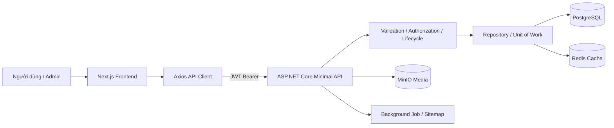

# Culinary Blog - Recipe & Ingredient Platform

## 1. Giới thiệu tổng quan

Culinary Blog là hệ thống chia sẻ công thức nấu ăn gồm Frontend Next.js, Backend ASP.NET Core API, PostgreSQL, Redis, MinIO và dịch vụ hỗ trợ chạy bằng Docker Compose.

README này mô tả toàn bộ nội dung 8 bữa thực hiện cho phạm vi **Recipe / Ingredient của Phạm Nguyễn Ngọc Phước**.

### Mục tiêu

- Xây dựng đầy đủ mô hình dữ liệu, cấu hình EF Core, repository và migration cho Recipe.
- Cung cấp API tạo, sửa, xem, lọc, chuyển trạng thái, xóa mềm, khôi phục, xóa vĩnh viễn và quản lý nguyên liệu.
- Chuẩn hóa tài liệu API, TypeScript types, API utility và shared components.
- Hoàn thiện Recipe Detail, Create Recipe và Edit Recipe trên giao diện.
- Bảo đảm dữ liệu 100 công thức trở lên, mỗi công thức có ít nhất 10 nguyên liệu hợp lệ và có thể kiểm thử trên Docker.

### Điều kiện thực hiện

**Input**

- .NET 10 SDK.
- Node.js 20 và npm.
- Docker Desktop với Docker Compose.
- File `.env` được tạo từ `.env.example`.
- Tài khoản người dùng, danh mục, dữ liệu công thức và JWT token khi kiểm thử API Protected.

**Đầu ra**

- Database PostgreSQL có schema, migration, dữ liệu mẫu và tối thiểu 100 Recipe.
- API Recipe hoàn chỉnh theo vòng đời Draft, Published, Archived và Deleted.
- Tài liệu OpenAPI/Scalar có Bearer Authentication.
- Frontend gồm danh sách, chi tiết, tạo mới và cập nhật công thức.
- Báo cáo build, lint và test cho backend/frontend.

## 2. Quy trình thực hiện 8 bữa

### Công nghệ và quy trình áp dụng

| Tầng | Công nghệ |
|---|---|
| Frontend | Next.js, React, TypeScript, Axios, React Hook Form, Zod, TanStack Query, Zustand |
| Backend | ASP.NET Core Minimal API, MediatR, EF Core, Npgsql |
| Database | PostgreSQL 16 |
| Cache/Job | Redis, Hangfire hoặc hosted background service |
| Storage | MinIO |
| Tài liệu API | OpenAPI và Scalar |
| Container | Docker, Docker Compose |
| Kiểm thử | xUnit, Jest, Vitest, Playwright |

Nguyên tắc áp dụng:

1. Phân tích yêu cầu và xác định entity, DTO, API, TypeScript type và trạng thái UI.
2. Thiết kế schema/database trước, sau đó phát triển backend và migration.
3. Dùng API utility chung và không tạo Axios client trùng lặp.
4. Component nhận dữ liệu bằng props/state, không hard-code dữ liệu nghiệp vụ.
5. Tách validation Backend/Frontend và giữ response API đồng nhất.
6. Kiểm tra quyền truy cập, xóa mềm, ETag/If-Match và dữ liệu quan hệ.
7. Chạy lint/build/test, rồi kiểm tra luồng bằng API và giao diện.

### Sơ đồ thực thi tổng thể



### Quy trình chi tiết từng bữa

#### Bữa 1 - Recipe Entity và dữ liệu ban đầu

- Xác định `Recipe`, `RecipeIngredient`, `RecipeNutrition`, `RecipeStatus`, `DifficultyLevel`.
- Hoàn thiện quan hệ Recipe - Author - Category - Ingredient.
- Thiết lập các trường cốt lõi: Title, Slug, Description, Content, Prep/Cook Time, Servings, PublishedAt.
- Chuẩn bị dữ liệu mẫu cho công thức, nguyên liệu và dinh dưỡng.
- **Output:** Entity/domain model và dữ liệu đầu vào phục vụ EF Core.

#### Bữa 2 - EF Core Configuration và Database Seeding

- Cấu hình bảng, độ dài, default value, unique index và composite index.
- Đặt `Servings` mặc định bằng 1.
- Ánh xạ `RecipeNutrition` dưới dạng Owned Entity.
- Cấu hình global query filter cho soft delete và optimistic concurrency.
- Seed ít nhất 100 Recipe, mỗi Recipe ít nhất 10 nguyên liệu hợp lệ.
- **Output:** Migration/database schema và dữ liệu seed trực tiếp trong PostgreSQL.

#### Bữa 3 - Repository, Unit of Work và truy vấn

- Rà soát toàn vẹn quan hệ User - Category - Recipe - Ingredient.
- Hoàn thiện repository, `SaveChangesAsync`, transaction và các thao tác thay thế dữ liệu con.
- Kiểm tra trùng slug, lọc, phân trang, split query và soft-delete query filter.
- Xử lý RowVersion/xmin và phát hiện update xung đột.
- **Output:** Tầng ghi dữ liệu nhất quán và truy vấn Recipe có hiệu quả.

#### Bữa 4 - Recipe Lifecycle API và giao diện luồng

- Triển khai Create, Update, Publish, Unpublish, Archive, Unarchive và soft Delete.
- Triển khai Admin Restore/Purge.
- Publish kiểm tra EmailConfirmed, Ingredient, Step và Category active.
- Dùng ETag/`If-Match`; trả `409 Conflict` khi xung đột.
- Lưu `RecipeSlugHistory`, Nutrition Source, sitemap job và dọn tài nguyên purged Recipe.
- Hoàn thiện Ingredient CRUD và quantity validation.
- **Output:** API lifecycle đầy đủ; giao diện xác nhận, trạng thái và thông báo lỗi.

#### Bữa 5 - API Documentation và Frontend Foundation

- Cấu hình OpenAPI và Scalar.
- Thêm Bearer Authentication cho API Documentation.
- Kiểm tra Method, Route, Parameter, Request và Response.
- Cài Axios, validation, form state, UI và thư viện test.
- Tạo `Recipe`, `RecipeSummary`, `RecipeDetail`, `RecipeIngredient`, `RecipeNutrition`, `RecipeStatus`, `DifficultyLevel`.
- Bảo đảm TypeScript types khớp DTO Backend.
- **Output:** Tài liệu API trực tuyến và frontend foundation có kiểu dữ liệu thống nhất.

#### Bữa 6 - API Utilities và Shared Components

- Tiếp tục dùng API client chung; chuẩn hóa GET, POST, PUT, PATCH, DELETE và query parameter.
- Hoàn thiện `lib/api/recipes.ts`.
- Xây dựng `RecipeCard`, `RecipeList`, `RecipeMeta`, `RecipeStatusBadge`, `DifficultyBadge`, `RecipeTimeInfo`.
- Layout Recipe Detail/Form tĩnh cho các bữa tiếp theo.
- **Output:** API utilities và component Recipe tái sử dụng được.

#### Bữa 7 - Recipe Detail Page

- Gọi `GET /api/v1/recipes/{slug}`.
- Hiển thị title, description, content, author, category, difficulty, time, servings, published date.
- Hiển thị ảnh chính/gallery, ingredients theo thứ tự, nutrition và steps theo số thứ tự.
- Tích hợp Step/Image ở chế độ hiển thị mà không sửa logic của component khác.
- Xử lý Loading Skeleton, 404, 403, Error và Empty state.
- **Output:** Trang chi tiết công thức responsive, phân quyền và đầy đủ dữ liệu.

#### Bữa 8 - Recipe Create, Update và Lifecycle UI

- Tạo Draft bằng `POST /api/v1/recipes`.
- Chỉnh sửa bằng `/recipes/[slug]/edit` và `PUT /api/v1/recipes/{id}`.
- Form đầy đủ Recipe Basic Information, Nutrition, Ingredient, Step và Image layout.
- Cập nhật các nút Publish, Unpublish, Archive, Unarchive, Delete.
- Nạp ETag và gửi `If-Match`; hiển thị thông báo conflict `409`.
- Kiểm thử Create, Save Draft, Edit, Publish, Archive, Delete và Restore/Purge.
- **Output:** Luồng quản lý vòng đời Recipe hoàn chỉnh ở Frontend và Backend.

### Luồng xử lý thực thi một Recipe

```text
Người dùng nhập Recipe Form
        |
        v
Frontend validate Title/Category/Quantity/Steps
        |
        v
POST/PUT /api/v1/recipes
        |
        v
Backend authorize + validate DTO
        |
        v
RecipeRepository/UnitOfWork lưu Recipe và children
        |
        +---- Gửi/ghi ETag/xmin
        +---- Ghi nutrition, ingredients và steps
        +---- Migration/seed đã áp dụng trên database
        |
        v
Publish lifecycle -> kiểm tra ingredient + step + category + email
        |
        v
Frontend cập nhật Status Badge / điều hướng chi tiết
```

## 3. Lệnh chạy dự án và thực thi nội dung 8 bữa

### 3.1 Cấu hình Docker và Database

Mở terminal tại thư mục gốc chứa `docker-compose.yml`.

```powershell
Copy-Item .env.example .env
```

Điền tối thiểu:

- `POSTGRES_PASSWORD`
- `JWT_KEY` với ít nhất 32 ký tự
- `MINIO_ROOT_USER`, `MINIO_ROOT_PASSWORD`
- `MINIO_ACCESS_KEY`, `MINIO_SECRET_KEY`
- `DEMO_PASSWORD`

Khởi động toàn bộ hệ thống và build image:

```powershell
docker compose up --build -d
docker compose ps
docker compose logs -f backend
docker compose logs -f frontend
```

Backend tự chạy EF migration và seed dữ liệu khi khởi động.

```powershell
docker compose restart backend
docker compose exec postgres psql -U postgres -d "PTUDWNC-2026-Nhom12"
```

Database được publish ra máy chủ tại `localhost:5433`; bên trong network Docker backend kết nối PostgreSQL qua `postgres:5432`.

Kiểm tra số Recipe và số nguyên liệu:

```sql
SELECT COUNT(*) AS recipe_count FROM "Recipes";

SELECT r."Id", r."Title", COUNT(i."Id") AS ingredient_count
FROM "Recipes" r
LEFT JOIN "RecipeIngredients" i ON i."RecipeId" = r."Id"
GROUP BY r."Id", r."Title"
ORDER BY ingredient_count ASC
LIMIT 20;
```

Dừng stack nhưng giữ dữ liệu Docker volume:

```powershell
docker compose down
```

Không sử dụng `docker compose down -v` nếu không muốn xóa toàn bộ PostgreSQL/MinIO data.

### 3.2 Lệnh chạy từng phần khi phát triển

#### Backend

```powershell
cd backend
dotnet restore CulinaryBlog.sln
dotnet build CulinaryBlog.sln
dotnet run --project src/CulinaryBlog.Api/CulinaryBlog.API.csproj
```

#### Frontend chính của hệ thống

Hai thư mục Frontend được phân biệt như sau:

- `frontend/` là ứng dụng được Docker Compose build và chạy tại cổng `3000`.
- `frontend/culinary-blog-web/` là ứng dụng Next.js 15 đang được sử dụng cho chức năng Recipe chi tiết, tạo mới và chỉnh sửa.

Chạy ứng dụng Next.js trong thư mục `frontend/`:

```powershell
cd frontend
npm install
npm run dev
```

Frontend subproject đã hoàn thiện Recipe Create/Edit và Recipe Detail:

```powershell
cd frontend/culinary-blog-web
npm install
npm run dev
```

### 3.3 Địa chỉ dịch vụ

| Thành phần | Địa chỉ |
|---|---|
| Frontend | http://localhost:3000 |
| Backend API | http://localhost:5000 |
| Health check | http://localhost:5000/health |
| Readiness | http://localhost:5000/health/ready |
| Scalar/OpenAPI UI | http://localhost:5000/scalar/v1 hoặc route Scalar được cấu hình |
| OpenAPI JSON | http://localhost:5000/openapi/v1.json |
| PostgreSQL | localhost:5433 |
| Redis | localhost:6380 |
| MinIO API / Console | http://localhost:9000 / http://localhost:9001 |
| Mailpit | http://localhost:8025 |

### 3.4 Lệnh thực thi kiểm tra nội dung 8 bữa

Build và lint Frontend Recipe:

```powershell
cd frontend/culinary-blog-web
npm run lint
npm run build
npm run test
npm run test:e2e
```

Chạy unit/integration test Backend:

```powershell
cd backend
dotnet test CulinaryBlog.sln
dotnet test tests/CulinaryBlog.UnitTests/CulinaryBlog.UnitTests.csproj
dotnet test tests/CulinaryBlog.IntegrationTests/CulinaryBlog.IntegrationTests.csproj
```

Kiểm tra Public API:

```powershell
curl.exe http://localhost:5000/api/v1/recipes?page=1&pageSize=10
curl.exe http://localhost:5000/api/v1/recipes/ngocphuoc-mau-091
curl.exe http://localhost:5000/openapi/v1.json
```

Kiểm tra Protected API không token:

```powershell
curl.exe -i -X POST http://localhost:5000/api/v1/recipes -H "Content-Type: application/json" -d "{}"
```

Kết quả mong đợi là `401 Unauthorized`.

Kiểm tra Protected API có token:

```powershell
$token = "<ACCESS_TOKEN>"
$headers = @{ Authorization = "Bearer $token" }
Invoke-RestMethod -Uri "http://localhost:5000/api/v1/recipes" -Method Get -Headers $headers
```

Kiểm tra CRUD/lifecycle bằng file HTTP của dự án:

```text
backend/recipes.http
```

Các request nên được chạy theo thứ tự:

1. Public `GET /api/v1/recipes`.
2. `POST /api/v1/recipes` để tạo Draft.
3. `PUT /api/v1/recipes/{id}` để cập nhật.
4. `POST /api/v1/recipes/{id}/publish`.
5. `POST /api/v1/recipes/{id}/unpublish`.
6. `POST /api/v1/recipes/{id}/archive`.
7. `POST /api/v1/recipes/{id}/unarchive`.
8. `DELETE /api/v1/recipes/{id}` để xóa mềm.
9. Admin `POST /api/v1/admin/recipes/{id}/restore`.
10. Admin `DELETE /api/v1/admin/recipes/{id}/purge`.

Đối với request có ETag, truyền header:

```text
If-Match: "<ETAG>"
```

Nếu Recipe version thay đổi, Backend trả `409 Conflict`.

## Tài liệu liên quan

- [Kiến trúc hệ thống](./ARCHITECTURE.md)
- [Hướng dẫn mã nguồn](./docs/SOURCE_CODE_GUIDE.md)
- [Hướng dẫn chạy và kiểm thử](./docs/PROJECT_GUIDE.md)
- [API Documentation](./docs/API_DOCUMENTATION.md)
