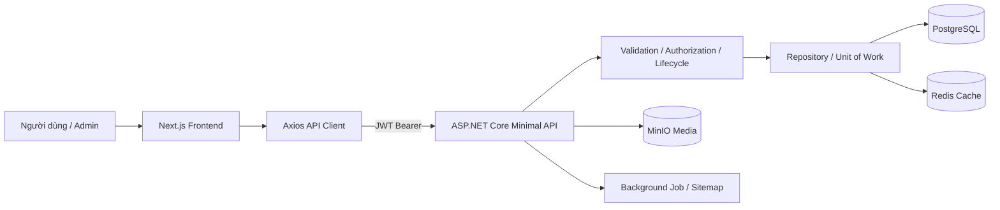
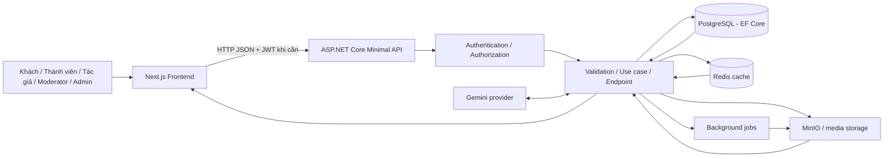
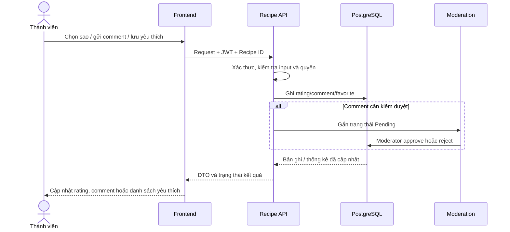
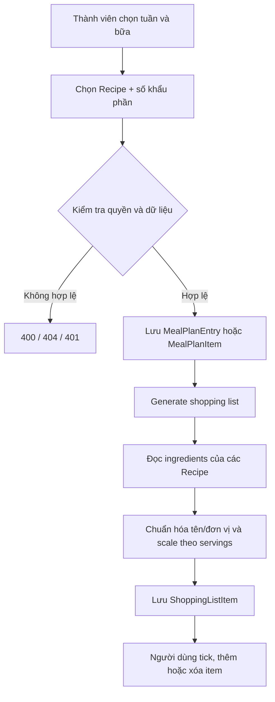
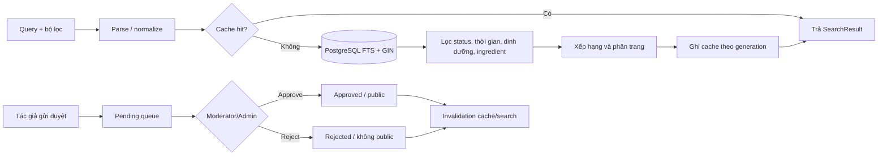

# Culinary Blog - Recipe & Ingredient Platform

## 1. Giới thiệu tổng quan

Culinary Blog là hệ thống chia sẻ công thức nấu ăn gồm Frontend Next.js, Backend ASP.NET Core API, PostgreSQL, Redis, MinIO và dịch vụ hỗ trợ chạy bằng Docker Compose.

README này mô tả toàn bộ nội dung 8 bữa thực hiện cho phạm vi **Recipe / Ingredient của Phạm Nguyễn Ngọc Phước**.

### Mục tiêu

- Xây dựng đầy đủ mô hình dữ liệu, cấu hình EF Core, repository và migration cho Recipe.
- Cung cấp API tạo, sửa, xem, lọc, chuyển trạng thái, xóa mềm, khôi phục, xóa vĩnh viễn và quản lý nguyên liệu.
- Chuẩn hóa tài liệu API, TypeScript types, API utility và shared components.
- Hoàn thiện Recipe Detail, Create Recipe và Edit Recipe trên giao diện.
- Bảo đảm dữ liệu 100 công thức trở lên, mỗi công thức có ít nhất 10 nguyên liệu hợp lệ và có thể kiểm thử trên Docker.

### Điều kiện thực hiện

**Input**

- .NET 10 SDK.
- Node.js 20 và npm.
- Docker Desktop với Docker Compose.
- File `.env` được tạo từ `.env.example`.
- Tài khoản người dùng, danh mục, dữ liệu công thức và JWT token khi kiểm thử API Protected.

**Đầu ra**

- Database PostgreSQL có schema, migration, dữ liệu mẫu và tối thiểu 100 Recipe.
- API Recipe hoàn chỉnh theo vòng đời Draft, Published, Archived và Deleted.
- Tài liệu OpenAPI/Scalar có Bearer Authentication.
- Frontend gồm danh sách, chi tiết, tạo mới và cập nhật công thức.
- Báo cáo build, lint và test cho backend/frontend.

## 2. Quy trình thực hiện 8 bữa

### Công nghệ và quy trình áp dụng

| Tầng          | Công nghệ                                                                      |
| -------------- | -------------------------------------------------------------------------------- |
| Frontend       | Next.js, React, TypeScript, Axios, React Hook Form, Zod, TanStack Query, Zustand |
| Backend        | ASP.NET Core Minimal API, MediatR, EF Core, Npgsql                               |
| Database       | PostgreSQL 16                                                                    |
| Cache/Job      | Redis, Hangfire hoặc hosted background service                                  |
| Storage        | MinIO                                                                            |
| Tài liệu API | OpenAPI và Scalar                                                               |
| Container      | Docker, Docker Compose                                                           |
| Kiểm thử     | xUnit, Jest, Vitest, Playwright                                                  |

Nguyên tắc áp dụng:

1. Phân tích yêu cầu và xác định entity, DTO, API, TypeScript type và trạng thái UI.
2. Thiết kế schema/database trước, sau đó phát triển backend và migration.
3. Dùng API utility chung và không tạo Axios client trùng lặp.
4. Component nhận dữ liệu bằng props/state, không hard-code dữ liệu nghiệp vụ.
5. Tách validation Backend/Frontend và giữ response API đồng nhất.
6. Kiểm tra quyền truy cập, xóa mềm, ETag/If-Match và dữ liệu quan hệ.
7. Chạy lint/build/test, rồi kiểm tra luồng bằng API và giao diện.

### Sơ đồ thực thi tổng thể



### Quy trình chi tiết từng bữa

#### Bữa 1 - Recipe Entity và dữ liệu ban đầu

- Xác định `Recipe`, `RecipeIngredient`, `RecipeNutrition`, `RecipeStatus`, `DifficultyLevel`.
- Hoàn thiện quan hệ Recipe - Author - Category - Ingredient.
- Thiết lập các trường cốt lõi: Title, Slug, Description, Content, Prep/Cook Time, Servings, PublishedAt.
- Chuẩn bị dữ liệu mẫu cho công thức, nguyên liệu và dinh dưỡng.
- **Output:** Entity/domain model và dữ liệu đầu vào phục vụ EF Core.

#### Bữa 2 - EF Core Configuration và Database Seeding

- Cấu hình bảng, độ dài, default value, unique index và composite index.
- Đặt `Servings` mặc định bằng 1.
- Ánh xạ `RecipeNutrition` dưới dạng Owned Entity.
- Cấu hình global query filter cho soft delete và optimistic concurrency.
- Seed ít nhất 100 Recipe, mỗi Recipe ít nhất 10 nguyên liệu hợp lệ.
- **Output:** Migration/database schema và dữ liệu seed trực tiếp trong PostgreSQL.

#### Bữa 3 - Repository, Unit of Work và truy vấn

- Rà soát toàn vẹn quan hệ User - Category - Recipe - Ingredient.
- Hoàn thiện repository, `SaveChangesAsync`, transaction và các thao tác thay thế dữ liệu con.
- Kiểm tra trùng slug, lọc, phân trang, split query và soft-delete query filter.
- Xử lý RowVersion/xmin và phát hiện update xung đột.
- **Output:** Tầng ghi dữ liệu nhất quán và truy vấn Recipe có hiệu quả.

#### Bữa 4 - Recipe Lifecycle API và giao diện luồng

- Triển khai Create, Update, Publish, Unpublish, Archive, Unarchive và soft Delete.
- Triển khai Admin Restore/Purge.
- Publish kiểm tra EmailConfirmed, Ingredient, Step và Category active.
- Dùng ETag/`If-Match`; trả `409 Conflict` khi xung đột.
- Lưu `RecipeSlugHistory`, Nutrition Source, sitemap job và dọn tài nguyên purged Recipe.
- Hoàn thiện Ingredient CRUD và quantity validation.
- **Output:** API lifecycle đầy đủ; giao diện xác nhận, trạng thái và thông báo lỗi.

#### Bữa 5 - API Documentation và Frontend Foundation

- Cấu hình OpenAPI và Scalar.
- Thêm Bearer Authentication cho API Documentation.
- Kiểm tra Method, Route, Parameter, Request và Response.
- Cài Axios, validation, form state, UI và thư viện test.
- Tạo `Recipe`, `RecipeSummary`, `RecipeDetail`, `RecipeIngredient`, `RecipeNutrition`, `RecipeStatus`, `DifficultyLevel`.
- Bảo đảm TypeScript types khớp DTO Backend.
- **Output:** Tài liệu API trực tuyến và frontend foundation có kiểu dữ liệu thống nhất.

#### Bữa 6 - API Utilities và Shared Components

- Tiếp tục dùng API client chung; chuẩn hóa GET, POST, PUT, PATCH, DELETE và query parameter.
- Hoàn thiện `lib/api/recipes.ts`.
- Xây dựng `RecipeCard`, `RecipeList`, `RecipeMeta`, `RecipeStatusBadge`, `DifficultyBadge`, `RecipeTimeInfo`.
- Layout Recipe Detail/Form tĩnh cho các bữa tiếp theo.
- **Output:** API utilities và component Recipe tái sử dụng được.

#### Bữa 7 - Recipe Detail Page

- Gọi `GET /api/v1/recipes/{slug}`.
- Hiển thị title, description, content, author, category, difficulty, time, servings, published date.
- Hiển thị ảnh chính/gallery, ingredients theo thứ tự, nutrition và steps theo số thứ tự.
- Tích hợp Step/Image ở chế độ hiển thị mà không sửa logic của component khác.
- Xử lý Loading Skeleton, 404, 403, Error và Empty state.
- **Output:** Trang chi tiết công thức responsive, phân quyền và đầy đủ dữ liệu.

#### Bữa 8 - Recipe Create, Update và Lifecycle UI

- Tạo Draft bằng `POST /api/v1/recipes`.
- Chỉnh sửa bằng `/recipes/[slug]/edit` và `PUT /api/v1/recipes/{id}`.
- Form đầy đủ Recipe Basic Information, Nutrition, Ingredient, Step và Image layout.
- Cập nhật các nút Publish, Unpublish, Archive, Unarchive, Delete.
- Nạp ETag và gửi `If-Match`; hiển thị thông báo conflict `409`.
- Kiểm thử Create, Save Draft, Edit, Publish, Archive, Delete và Restore/Purge.
- **Output:** Luồng quản lý vòng đời Recipe hoàn chỉnh ở Frontend và Backend.

### Luồng xử lý thực thi một Recipe

```text
Người dùng nhập Recipe Form
        |
        v
Frontend validate Title/Category/Quantity/Steps
        |
        v
POST/PUT /api/v1/recipes
        |
        v
Backend authorize + validate DTO
        |
        v
RecipeRepository/UnitOfWork lưu Recipe và children
        |
        +---- Gửi/ghi ETag/xmin
        +---- Ghi nutrition, ingredients và steps
        +---- Migration/seed đã áp dụng trên database
        |
        v
Publish lifecycle -> kiểm tra ingredient + step + category + email
        |
        v
Frontend cập nhật Status Badge / điều hướng chi tiết
```

## 3. Lệnh chạy dự án và thực thi nội dung 8 bữa

### 3.1 Cấu hình Docker và Database

Mở terminal tại thư mục gốc chứa `docker-compose.yml`.

```powershell
Copy-Item .env.example .env
```

Điền tối thiểu:

- `POSTGRES_PASSWORD`
- `JWT_KEY` với ít nhất 32 ký tự
- `MINIO_ROOT_USER`, `MINIO_ROOT_PASSWORD`
- `MINIO_ACCESS_KEY`, `MINIO_SECRET_KEY`
- `DEMO_PASSWORD`

Khởi động toàn bộ hệ thống và build image:

```powershell
docker compose up --build -d
docker compose ps
docker compose logs -f backend
docker compose logs -f frontend
```

Backend tự chạy EF migration và seed dữ liệu khi khởi động.

```powershell
docker compose restart backend
docker compose exec postgres psql -U postgres -d "PTUDWNC-2026-Nhom12"
```

Database được publish ra máy chủ tại `localhost:5433`; bên trong network Docker backend kết nối PostgreSQL qua `postgres:5432`.

Kiểm tra số Recipe và số nguyên liệu:

```sql
SELECT COUNT(*) AS recipe_count FROM "Recipes";

SELECT r."Id", r."Title", COUNT(i."Id") AS ingredient_count
FROM "Recipes" r
LEFT JOIN "RecipeIngredients" i ON i."RecipeId" = r."Id"
GROUP BY r."Id", r."Title"
ORDER BY ingredient_count ASC
LIMIT 20;
```

Dừng stack nhưng giữ dữ liệu Docker volume:

```powershell
docker compose down
```

Không sử dụng `docker compose down -v` nếu không muốn xóa toàn bộ PostgreSQL/MinIO data.

### 3.2 Lệnh chạy từng phần khi phát triển

#### Backend

```powershell
cd backend
dotnet restore CulinaryBlog.sln
dotnet build CulinaryBlog.sln
dotnet run --project src/CulinaryBlog.Api/CulinaryBlog.API.csproj
```

#### Frontend chính của hệ thống

Hai thư mục Frontend được phân biệt như sau:

- `frontend/` là ứng dụng được Docker Compose build và chạy tại cổng `3000`.
- `frontend/culinary-blog-web/` là ứng dụng Next.js 15 đang được sử dụng cho chức năng Recipe chi tiết, tạo mới và chỉnh sửa.

Chạy ứng dụng Next.js trong thư mục `frontend/`:

```powershell
cd frontend
npm install
npm run dev
```

Frontend subproject đã hoàn thiện Recipe Create/Edit và Recipe Detail:

```powershell
cd frontend/culinary-blog-web
npm install
npm run dev
```

### 3.3 Địa chỉ dịch vụ

| Thành phần        | Địa chỉ                                                            |
| ------------------- | --------------------------------------------------------------------- |
| Frontend            | http://localhost:3000                                                 |
| Backend API         | http://localhost:5000                                                 |
| Health check        | http://localhost:5000/health                                          |
| Readiness           | http://localhost:5000/health/ready                                    |
| Scalar/OpenAPI UI   | http://localhost:5000/scalar/v1 hoặc route Scalar được cấu hình |
| OpenAPI JSON        | http://localhost:5000/openapi/v1.json                                 |
| PostgreSQL          | localhost:5433                                                        |
| Redis               | localhost:6380                                                        |
| MinIO API / Console | http://localhost:9000 / http://localhost:9001                         |
| Mailpit             | http://localhost:8025                                                 |

### 3.4 Lệnh thực thi kiểm tra nội dung 8 bữa

Build và lint Frontend Recipe:

```powershell
cd frontend/culinary-blog-web
npm run lint
npm run build
npm run test
npm run test:e2e
```

Chạy unit/integration test Backend:

```powershell
cd backend
dotnet test CulinaryBlog.sln
dotnet test tests/CulinaryBlog.UnitTests/CulinaryBlog.UnitTests.csproj
dotnet test tests/CulinaryBlog.IntegrationTests/CulinaryBlog.IntegrationTests.csproj
```

Kiểm tra Public API:

```powershell
curl.exe http://localhost:5000/api/v1/recipes?page=1&pageSize=10
curl.exe http://localhost:5000/api/v1/recipes/ngocphuoc-mau-091
curl.exe http://localhost:5000/openapi/v1.json
```

Kiểm tra Protected API không token:

```powershell
curl.exe -i -X POST http://localhost:5000/api/v1/recipes -H "Content-Type: application/json" -d "{}"
```

Kết quả mong đợi là `401 Unauthorized`.

Kiểm tra Protected API có token:

```powershell
$token = "<ACCESS_TOKEN>"
$headers = @{ Authorization = "Bearer $token" }
Invoke-RestMethod -Uri "http://localhost:5000/api/v1/recipes" -Method Get -Headers $headers
```

Kiểm tra CRUD/lifecycle bằng file HTTP của dự án:

```text
backend/recipes.http
```

Các request nên được chạy theo thứ tự:

1. Public `GET /api/v1/recipes`.
2. `POST /api/v1/recipes` để tạo Draft.
3. `PUT /api/v1/recipes/{id}` để cập nhật.
4. `POST /api/v1/recipes/{id}/publish`.
5. `POST /api/v1/recipes/{id}/unpublish`.
6. `POST /api/v1/recipes/{id}/archive`.
7. `POST /api/v1/recipes/{id}/unarchive`.
8. `DELETE /api/v1/recipes/{id}` để xóa mềm.
9. Admin `POST /api/v1/admin/recipes/{id}/restore`.
10. Admin `DELETE /api/v1/admin/recipes/{id}/purge`.

Đối với request có ETag, truyền header:

```text
If-Match: "<ETAG>"
```

Nếu Recipe version thay đổi, Backend trả `409 Conflict`.

## Tài liệu liên quan

- [Kiến trúc hệ thống](./ARCHITECTURE.md)
- [Hướng dẫn mã nguồn](./docs/SOURCE_CODE_GUIDE.md)
- [Hướng dẫn chạy và kiểm thử](./docs/PROJECT_GUIDE.md)
- [API Documentation](./docs/API_DOCUMENTATION.md)

## 4. Báo cáo chi tiết lộ trình phát triển bốn đợt dành cho cá nhân.

Phần này tổng hợp phạm vi nghiệp vụ, luồng xử lý, vai trò, dữ liệu vào/ra và bằng chứng triển khai của bốn đợt. “Có endpoint/entity/migration” xác nhận mã nguồn đã có phần backend tương ứng; không tự động chứng minh frontend đã nối đầy đủ hoặc tính năng đã được nghiệm thu end-to-end trên môi trường triển khai. Đợt 3 cần xác minh tích hợp; Đợt 4 là lộ trình nâng cao, một số hạng mục đã có backend support nhưng chưa được xem là hoàn tất toàn hệ thống.

### 4.1 Mục tiêu hệ thống và phạm vi

CulinaryBlog là nền tảng công thức nấu ăn. Hệ thống hỗ trợ tác giả tạo và xuất bản công thức, người đọc tìm kiếm và tương tác, người dùng cá nhân lập kế hoạch bữa ăn, và quản trị viên/kiểm duyệt viên quản lý nội dung. PostgreSQL là nguồn dữ liệu chính; API ASP.NET Core cung cấp các use case; Next.js cung cấp giao diện; Redis hỗ trợ cache; object storage và background jobs phục vụ xử lý media.

Mục tiêu xuyên suốt:

1. Dữ liệu công thức có cấu trúc, gồm tác giả, danh mục, nguyên liệu, dinh dưỡng, ảnh và các bước nấu.
2. Tách quyền người dùng theo nghiệp vụ, không chỉ ẩn nút trên giao diện.
3. Bảo toàn tính nhất quán khi cập nhật, kiểm duyệt, khôi phục phiên bản và tạo danh sách tổng hợp.
4. Cho phép tìm, khám phá, lập kế hoạch và theo dõi dinh dưỡng trên cùng dữ liệu Recipe.
5. Để các chức năng AI/media bổ sung trải nghiệm, nhưng không cho kết quả do AI sinh tự ý tạo hoặc sửa Recipe đã lưu.

Ngoài phạm vi triển khai đã xác nhận là các giao diện end-to-end cho mọi tính năng của cả bốn đợt. Trạng thái cụ thể được nêu trong từng đợt và cần được đối chiếu với test/deployment thực tế.

### 4.2 Vai trò và quyền truy cập

| Vai trò                  | Mục tiêu                                | Quyền/nghiệp vụ chính                                                                                                                                                                              |
| ------------------------- | ----------------------------------------- | ------------------------------------------------------------------------------------------------------------------------------------------------------------------------------------------------------ |
| Khách chưa đăng nhập | Khám phá nội dung công khai           | Xem công thức/danh mục đã xuất bản, tìm kiếm và xem thông tin công khai; không thao tác dữ liệu cá nhân.                                                                             |
| Thành viên              | Lưu và quản lý hoạt động cá nhân | Đánh dấu yêu thích, đánh giá, bình luận, lập meal plan và shopping list, theo dõi tác giả, xem feed và quản lý mục tiêu dinh dưỡng. API cá nhân yêu cầu JWT.                 |
| Tác giả                 | Tạo và duy trì nội dung               | Tạo/sửa công thức của mình, quản lý ảnh/ingredient/step, gửi duyệt và xem lịch sử; nội dung Draft/Archived được backend giới hạn theo quyền sở hữu hoặc vai trò được cấp. |
| Moderator                 | Duyệt nội dung cộng đồng             | Xem hàng đợi chờ duyệt và approve/reject recipe/comment theo policy.                                                                                                                             |
| Admin                     | Quản trị hệ thống                     | Có quyền quản trị moderation và quản lý user/recipe theo các endpoint Admin; thao tác đặc quyền vẫn cần authorization ở backend.                                                        |

Mọi request cần xác thực dùng JWT Bearer. Các route cá nhân trong `/api/v1/me` yêu cầu đăng nhập; moderation yêu cầu role `Admin` hoặc `Moderator`; các route quản trị giới hạn theo role tương ứng. Quyền truy cập dữ liệu riêng tư phải được kiểm tra trên server theo user hiện tại, không dựa vào `userId` gửi từ client.

### 4.3 Kiến trúc và luồng thực thi tổng thể



**Đặc tả luồng request:**

| Bước | Thành phần             | Xử lý                                                                                                                                               | Kết quả                                                                      |
| ------ | ------------------------ | ----------------------------------------------------------------------------------------------------------------------------------------------------- | ------------------------------------------------------------------------------ |
| 1      | Người dùng / Frontend | Thu thập input và gọi API phù hợp. Gửi access token cho route protected; gửi `If-Match` với thao tác Recipe có optimistic concurrency.    | HTTP request có route, query/body và thông tin xác thực cần thiết.      |
| 2      | API                      | Xác thực JWT, kiểm tra role/resource ownership, giới hạn tốc độ nếu endpoint có policy và kiểm tra input.                                 | Trả lỗi `401/403/400/404/409/429` phù hợp khi không đạt điều kiện. |
| 3      | Use case / endpoint      | Đọc hoặc cập nhật entity, áp dụng quy tắc miền; gom dữ liệu con và ghi revision/activity khi phù hợp.                                   | DTO/response đã được giới hạn theo quyền và trạng thái nội dung.   |
| 4      | Infrastructure           | EF Core truy cập PostgreSQL; cache được đọc/invalidated khi endpoint hỗ trợ; file và tác vụ ảnh đi qua storage/job service tương ứng. | Dữ liệu bền vững hoặc kết quả tích hợp được trả về.              |
| 5      | Frontend                 | Hiển thị kết quả, trạng thái loading/error/empty và thông báo quyền/lỗi.                                                                   | Người dùng thấy trạng thái nghiệp vụ đã cập nhật.                  |

### 4.4 Đợt 1 — Tương tác người dùng (User Engagement)

**Mục tiêu:** tăng tương tác có kiểm soát quanh một Recipe: người đọc đánh giá, trao đổi, lưu lại; tác giả duy trì hồ sơ công khai/cá nhân.

**Vai trò:** khách xem được nội dung tương tác công khai đã được phép hiển thị; thành viên đã đăng nhập tạo/sửa/xóa tương tác của chính mình; moderator/admin xử lý nội dung cần kiểm duyệt.

**Input và xử lý:**

| Nghiệp vụ     | Input                                               | Quy tắc xử lý                                                                                                                                                                                                                                    |
| --------------- | --------------------------------------------------- | --------------------------------------------------------------------------------------------------------------------------------------------------------------------------------------------------------------------------------------------------- |
| Rating 1–5 sao | Recipe ID, điểm số; danh tính lấy từ JWT      | Một người dùng có một rating cho một Recipe; có thể cập nhật/xóa rating của mình. Điểm tổng hợp được trả cùng thống kê rating; cần bảo đảm unique constraint/index và transaction ở database.                        |
| Comment / reply | Recipe ID, nội dung,`ParentCommentId` tùy chọn | Tạo comment dạng gốc hoặc reply. Server xác nhận Recipe/parent hợp lệ, gắn tác giả từ JWT và áp dụng lọc/moderation. Trạng thái ban đầu có thể Pending; chỉ comment được duyệt mới xuất hiện trong luồng công khai. |
| Favorite        | Recipe ID                                           | Toggle trạng thái yêu thích của user hiện tại; danh sách cá nhân có phân trang và trạng thái có thể truy vấn riêng.                                                                                                              |
| Hồ sơ         | Thông tin profile được phép cập nhật         | Server ràng buộc thao tác vào user hiện tại; thông tin profile được dùng để hiển thị tên/avatar tác giả.                                                                                                                          |

**Luồng Rating / Comment / Favorite:**



**Output:** rating summary và trạng thái rating cá nhân; comment/reply kèm trạng thái kiểm duyệt; danh sách Recipe yêu thích; dữ liệu profile. Dữ liệu chưa được duyệt không được trình bày như nội dung công khai đã xác nhận.

**API chính trong mã nguồn:**

- `GET /api/v1/recipes/{id}/ratings`, `PUT /api/v1/recipes/{id}/ratings/me`, `DELETE /api/v1/recipes/{id}/ratings/me`.
- `GET/POST /api/v1/recipes/{id}/comments`, `PUT/DELETE /api/v1/recipes/{id}/comments/{commentId}`.
- `POST/GET /api/v1/recipes/{id}/favorite` và `GET /api/v1/me/favorites`.
- Profile/authentication được cung cấp trong nhóm Auth/User.
- Moderator: `GET /api/v1/admin/moderation/pending`, cùng các endpoint approve/reject recipe/comment.

**Tiêu chí nghiệm thu đề xuất:** chặn rating ngoài 1–5; chống rating trùng; chỉ chủ sở hữu hoặc moderator/admin có quyền sửa/xóa nội dung; comment reply tham chiếu đúng parent; kiểm thử nội dung bị lọc, trạng thái Pending/Approved/Rejected và phân trang favorite. Mã nguồn có endpoint và entity liên quan; cần chạy API integration test để xác nhận hành vi trên database mục tiêu.

### 4.5 Đợt 2 — Lập thực đơn và tiện ích (Meal Planning & Utilities)

**Mục tiêu:** biến danh sách Recipe thành lịch bữa ăn, tạo checklist mua nguyên liệu và hỗ trợ điều chỉnh khẩu phần/xuất bản in.

**Vai trò:** thành viên đã đăng nhập quản lý meal plan và shopping list của mình; khách có thể xem/xuất một Recipe công khai nếu endpoint cho phép.

**Input và output theo nghiệp vụ:**

| Nghiệp vụ                  | Input                                                                                  | Output                                                                                                             |
| ---------------------------- | -------------------------------------------------------------------------------------- | ------------------------------------------------------------------------------------------------------------------ |
| Lịch tuần (legacy)         | Khoảng ngày, meal type, Recipe ID; thao tác CRUD dùng các endpoint `/meal-plan` | Các mục ngày/bữa gắn Recipe; trang `frontend/app/meal-planner/page.tsx` hiện dùng contract legacy.        |
| Shopping list (legacy)       | Nguyên liệu tự nhập hoặc khoảng ngày để generate                              | Danh sách item, số lượng/đơn vị và trạng thái `isChecked`; hỗ trợ thêm, đánh dấu đã mua, xóa. |
| Meal plan v2                 | Title, ngày bắt đầu/kết thúc; Recipe ID, ngày, meal type, servings, note        | Entity `MealPlans` → `MealPlanItems`; có thể tạo list từ các mục của plan.                             |
| Shopping list v2             | Tên list, Recipe IDs tùy chọn và target servings                                   | Entity `ShoppingLists` → `ShoppingListItems`, có phân trang, item count và checklist.                      |
| Batch cooking / scale Recipe | Slug và servings mục tiêu                                                           | Preview hoặc kết quả ingredient/nutrition đã nhân theo hệ số servings mới.                                |
| Recipe export/print          | Slug Recipe đã được phép đọc                                                   | PDF có thể tải/xem in; cần kiểm thử font, ảnh, trang dài và quyền truy cập.                             |

**Sơ đồ lập thực đơn → danh sách đi chợ:**



**API liên quan:**

- Legacy: `GET/PUT/DELETE /api/v1/me/meal-plan`, `GET/POST /api/v1/me/shopping-list`, `POST /api/v1/me/shopping-list/generate`, và route check/delete theo item.
- V2: `/api/v1/me/meal-plans` và `/api/v1/me/shopping-lists`, gồm tạo/list/detail/item/generate.
- Recipe tiện ích: `GET /api/v1/recipes/{slug}/servings`, `POST /api/v1/recipes/{slug}/scale`, `GET /api/v1/recipes/{slug}/export/pdf`.

**Lưu ý tương thích:** hệ thống có hai mô hình cùng tồn tại. Trang meal planner hiện gọi endpoint legacy và ghi vào `MealPlanEntries`/`ShoppingListItems`; mô hình v2 có migration `20261104082500_AddPersonalPlanningV2.cs` và route riêng trong `PlanningEndpoints.cs`. Không được coi trang hiện hành là đã chuyển sang v2 chỉ vì API v2 đã tồn tại. Cần quyết định migration UI, đồng bộ dữ liệu hoặc duy trì hai contract trước khi loại bỏ legacy.

**Tiêu chí nghiệm thu đề xuất:** cô lập dữ liệu theo user; ngày/bữa hợp lệ; không nhận Recipe riêng tư/không xuất bản khi tạo kế hoạch công khai; tính lượng theo serving; đơn vị không tương thích không được cộng gộp sai; checklist lưu trạng thái; kiểm thử ranh giới tuần, timezone/ngày và phản hồi phân trang.

### 4.6 Đợt 3 — Tìm kiếm và quản trị (Search & Governance)

**Mục tiêu:** giúp khám phá Recipe bằng truy vấn có ý nghĩa, đồng thời hỗ trợ audit, rollback và kiểm duyệt an toàn.

**Tìm kiếm thông minh**

- Input: `q`, danh mục, difficulty, thời gian nấu tối đa, ngưỡng Calories/Protein/Carbohydrates/Fat, rating, ingredient include/exclude, sort và pagination.
- Xử lý: chuẩn hóa/parse query; lọc chỉ Recipe đã xuất bản/approved, chưa xóa; kết hợp PostgreSQL full-text và fallback tìm chuỗi không dấu trên title/description/content/ingredient/step; tạo cache key có thế hệ invalidation.
- Output: danh sách Recipe, metadata phân trang và thông tin truy vấn đã parse; suggestions trả riêng.
- API: `GET /api/v1/search/recipes`, `GET /api/v1/search/suggestions`; Recipe API cũng có search riêng.
- Data/index: migration mở rộng search vector dùng `unaccent`, `to_tsvector`, weighting Title cao hơn Description; migration index search có GIN/trigram. Search filter hỗ trợ nhiều trường dinh dưỡng và ingredient.

**Revision history và rollback**

- Input: Recipe ID, version; compare nhận `v1`, `v2`; rollback nhận version cần khôi phục.
- Xử lý: lưu snapshot trước/sau thay đổi theo version, cho phép đọc lịch sử/so sánh và rollback. Rollback áp dụng snapshot như nội dung Recipe mới và tăng version; không xóa dấu vết lịch sử cũ.
- Output: danh sách revision, snapshot, chênh lệch hai version hoặc Recipe phục hồi.
- API: `/api/v1/recipes/{id}/revisions`, `/{version}`, `/compare`, `/{version}/rollback`.
- Quyền: endpoint revision yêu cầu xác thực và `CanManage` kiểm tra khả năng quản lý Recipe; rollback cũng invalidates cache.

**Content moderation**

- Input: Recipe gửi duyệt hoặc comment/recipe trong trạng thái chờ.
- Xử lý: lọc từ khóa/ngữ liệu theo validation hiện có, đưa nội dung vào trạng thái chờ; Moderator/Admin lấy pending rồi approve/reject. Mọi quyết định gắn trạng thái kiểm duyệt; dữ liệu công khai chỉ lấy status public.
- Output: trạng thái mới và moderation log phục vụ truy vết.
- API: `POST /api/v1/recipes/{id}/submit-for-approval`; `/api/v1/admin/moderation/pending`; approve/reject recipe/comment.

**Cache**

- Redis được tích hợp cho Recipe detail/search/feed và có các cơ chế invalidation/generation key ở các luồng tương ứng. Cache không phải nguồn dữ liệu chuẩn; khi Redis không sẵn sàng, hành vi fallback phụ thuộc cache service/endpoint cụ thể. Không khẳng định mọi API đều được cache.

**Sơ đồ tìm kiếm và kiểm duyệt:**



**Tiêu chí nghiệm thu đề xuất:** kiểm thử dấu/không dấu, phrase và fuzzy fallback; lọc status và xóa mềm; phân trang ổn định; invalidation sau update/publish/moderation; kiểm tra role/ownership và version cạnh tranh khi rollback; không đưa nội dung Pending/Rejected vào search hoặc feed public.

**Trạng thái:** route, migration và logic backend có trong source. Theo phạm vi báo cáo hiện tại, đợt này hoàn tất triển khai nhưng đang chờ verify backend/tích hợp. Cần chạy test với PostgreSQL/Redis thực tế và xác nhận query plans, migrations, authorization, cache invalidation; không dùng việc source tồn tại làm bằng chứng deployment đã đạt.

### 4.7 Đợt 4 — Tính năng nâng cao (Advanced Features)

**Mục tiêu:** mở rộng hệ thống từ recipe catalog sang cộng đồng, trợ lý nhập liệu và theo dõi dinh dưỡng/media.

| Hạng mục                       | Input                                                                        | Luồng xử lý / output                                                                                                                                                                           | Trạng thái source                                                                                                                                                                                                 |
| -------------------------------- | ---------------------------------------------------------------------------- | ------------------------------------------------------------------------------------------------------------------------------------------------------------------------------------------------- | ------------------------------------------------------------------------------------------------------------------------------------------------------------------------------------------------------------------- |
| Follow / Activity Feed           | User ID tác giả để follow; pagination cho feed                           | Lưu quan hệ follow; feed lấy hoạt động và Recipe công khai từ các tác giả đang theo dõi; cache feed theo user/page và generation.                                                  | API backend trong `SocialNutritionEndpoints`; cần xác nhận giao diện và E2E.                                                                                                                                 |
| Gợi ý Recipe từ nguyên liệu | Từ 1 đến 30 nguyên liệu có sẵn                                        | Lọc candidate Recipe public từ database trước; AI chỉ xếp hạng/chọn ID thuộc danh sách cho phép; trả tối đa 5 Recipe, không tự bịa Recipe ID.                                    | API `POST /api/v1/ai/suggest-by-ingredients`, yêu cầu xác thực và rate limiting.                                                                                                                             |
| OCR Recipe                       | Multipart image field `image`; JPEG/PNG/WebP/AVIF; tối đa 5 MB           | Validate kích thước/định dạng; model tạo JSON draft gồm thông tin Recipe, ingredient, step; server parse/validate và trả bản nháp để user xem lại, không tự lưu thành Recipe. | API `POST /api/v1/ai/ocr-recipe` và provider Gemini có trong source. Model mặc định hiện cấu hình là `gemini-2.5-flash`; không ghi cố định phiên bản 1.5 nếu cấu hình runtime có thể đổi. |
| Nutrition goals                  | Tuổi, giới tính, chiều cao, cân nặng, mức hoạt động và mục tiêu | Calculator áp dụng Mifflin-St Jeor, hệ số hoạt động, điều chỉnh goal; trả calorie/protein/carbohydrate/fat targets; đánh dấu meal consumed để tổng hợp dinh dưỡng.            | API và calculator backend có; cần xác nhận UI và so sánh kết quả với test cases nghiệp vụ.                                                                                                              |
| Watermark / image variants       | Ảnh Recipe và ID ảnh                                                      | Background image job tạo medium/thumbnail, đóng watermark `CULINARYBLOG` lên biến thể và lưu qua storage.                                                                               | Job/service có trong source; cần xác nhận Hangfire/storage hoạt động trong deployment và format/quality ảnh theo cấu hình.                                                                               |

**Sơ đồ luồng OCR có kiểm soát:**

```mermaid
sequenceDiagram
    actor U as Tác giả
    participant UI as Frontend
    participant API as AI API
    participant V as Image/DTO Validator
    participant AI as Gemini provider
    U->>UI: Chọn ảnh ghi chú công thức
    UI->>API: POST multipart image + JWT
    API->>V: Kiểm MIME, kích thước, ảnh hợp lệ
    V-->>API: Ảnh hợp lệ (tối đa 5 MB)
    API->>AI: Yêu cầu OCR và JSON có cấu trúc
    AI-->>API: Bản nháp OCR
    API->>V: Parse, kiểm tra và chuẩn hóa draft
    API-->>UI: Recipe draft; không ghi database
    UI-->>U: Tác giả rà soát/chỉnh sửa rồi chủ động lưu
```

**Nutrition Goal** nhận các input cá nhân nhạy cảm ở mức sức khỏe cơ bản; chỉ user sở hữu được đọc/cập nhật mục tiêu của mình. Kết quả là ước tính phục vụ tham khảo, không phải chẩn đoán hay chỉ định y tế. API ghi nhận bữa đã dùng để tính tổng Calories và macros theo servings/portion, nhưng cần verify chính xác dữ liệu dinh dưỡng cho Recipe thiếu field hoặc servings bất thường.

**Tiêu chí nghiệm thu đề xuất:** không cho AI trả ID ngoài candidate whitelist; báo lỗi provider, timeout, JSON sai, ảnh quá lớn/không hỗ trợ; OCR không lưu nếu user chưa xác nhận; follow/feed không lộ hoạt động private; user không đọc được goal của người khác; nutrition validation chặn input ngoài miền; job media retry/failure có log và không làm hỏng ảnh gốc.

**Trạng thái:** các luồng chính của Đợt 4 đã có thành phần backend và frontend trong source: API follow/feed và mục tiêu dinh dưỡng; các trang feed, nutrition, suggestions; nút follow; widget gợi ý nguyên liệu; modal OCR được gắn vào luồng tạo Recipe; calculator dinh dưỡng; và background job xử lý ảnh có watermark. Database có migration cho social/nutrition. Đây là xác nhận về thành phần mã nguồn, không thay thế kiểm thử end-to-end hoặc xác nhận deployment: cần kiểm tra cấu hình Gemini, PostgreSQL, cache, storage/job runner, quyền truy cập và các tình huống lỗi trước khi tuyên bố nghiệm thu toàn hệ thống.

### 4.8 Bảng tổng hợp trạng thái và đầu ra

| Đợt | Trọng tâm                                   | Đầu ra chính                                                                   | Trạng thái báo cáo                                                                                       |
| ----- | --------------------------------------------- | --------------------------------------------------------------------------------- | ------------------------------------------------------------------------------------------------------------ |
| 1     | Rating, comment/reply, favorite, profile      | API tương tác, dữ liệu review, kiểm duyệt comment và hồ sơ thành viên | Hoàn tất theo lộ trình; cần đối chiếu coverage UI/E2E khi nghiệm thu.                               |
| 2     | Meal plan, shopping list, scaling, PDF/print  | Lịch bữa, checklist mua sắm, tiện ích khẩu phần và export                 | Hoàn tất theo lộ trình; legacy UI và API v2 song song, chưa mặc định đã hợp nhất.               |
| 3     | Full-text search, moderation, revision, Redis | Kết quả tìm kiếm nâng cao, revision/rollback, luồng kiểm duyệt và cache  | Hoàn tất triển khai theo source, đang chờ verify backend và tích hợp.                                |
| 4     | Social, AI/OCR, nutrition, media watermark    | Follow/feed, draft OCR/suggestions, nutrition goals, ảnh xử lý nền            | Đã có các API, UI và job chính trong source; cần xác minh tích hợp, kiểm thử E2E và deployment. |

### 4.9 So sánh hệ thống trước và sau 4 đợt cải tiến

Bảng này so sánh phạm vi nền tảng Recipe ban đầu với năng lực được bổ sung qua cả bốn đợt. Các đợt là phần mở rộng theo lớp: chức năng mới dùng lại Recipe, người dùng, database và các luồng API hiện có, không thay thế nền tảng ban đầu. “Có trong source” mô tả implementation trong repository; không tự xác nhận đã triển khai production hoặc nghiệm thu end-to-end.

| Khía cạnh | Trước 4 đợt cải tiến | Sau 4 đợt cải tiến |
|---|---|---|
| Mục đích sử dụng | Tập trung vào hệ thống Recipe: quản lý và khám phá công thức cùng dữ liệu liên quan. | Trở thành nền tảng Recipe có thêm tương tác cộng đồng, lập kế hoạch bữa ăn, tìm kiếm/quản trị nội dung và hỗ trợ AI/dinh dưỡng/media. |
| Nội dung Recipe | Recipe, Category, Ingredient, Step, Nutrition, Image và thông tin tác giả là dữ liệu cốt lõi. | Giữ nguyên mô hình cốt lõi; bổ sung rating/comment/favorite, trạng thái và quy trình duyệt, revision history, tìm kiếm/filter nâng cao và dữ liệu dùng cho feed, AI, nutrition. |
| Trải nghiệm cá nhân | Người dùng chủ yếu đăng nhập và thao tác trong các luồng tài khoản/Recipe sẵn có. | Người dùng có thêm danh sách yêu thích, meal plan, shopping list, mục tiêu và tổng hợp dinh dưỡng, theo dõi tác giả và feed cá nhân. |
| Tìm kiếm và quản trị | Khả năng khám phá/quản lý cơ bản theo các luồng Recipe hiện hữu. | Có full-text search/filter, lịch sử phiên bản và rollback, moderation queue, trạng thái duyệt và cache/invalidation ở các luồng hỗ trợ. |
| Hỗ trợ nâng cao | Chưa có các luồng cộng đồng/AI/dinh dưỡng/media của Đợt 4 trong baseline mô tả. | Có follow/feed, gợi ý món từ nguyên liệu, OCR trả draft để người dùng xem lại, tính mục tiêu dinh dưỡng và job xử lý ảnh/watermark trong source. |
| Thành phần kỹ thuật | Domain/API Recipe, xác thực, persistence PostgreSQL, giao diện và hạ tầng ảnh là nền tảng chung. | Mở rộng Domain entities/enums, API endpoints, EF configurations/migrations, infrastructure services/jobs/cache, frontend routes/components/API clients và test tương ứng cho các năng lực mới. |

#### Thành phần được bổ sung theo từng đợt

| Đợt | Cải tiến so với baseline | Thành phần mã nguồn tiêu biểu |
|---|---|---|
| 1 — Tương tác người dùng | Rating 1–5 sao, comment/reply, favorite/bookmark, profile và kiểm soát nội dung tương tác. | `RecipeRating`, `RecipeComment`, `RecipeFavorite`; recipe interaction endpoints và UI panel; quy tắc ownership, unique constraint và trạng thái moderation. |
| 2 — Lập thực đơn và tiện ích | Meal plan theo ngày/bữa, shopping list/checklist, scale theo servings, export/print. | `MealPlanEntry`/`ShoppingListItem` legacy và `MealPlan`/`MealPlanItem` v2; `MealPlanEndpoints.cs`, `PlanningEndpoints.cs`; migration và giao diện planner. Lưu ý: trang planner hiện dùng contract legacy, chưa mặc định chuyển sang v2. |
| 3 — Tìm kiếm và quản trị | Full-text search và filter, revision/rollback, moderation, Redis caching/invalidation. | `SearchEndpoints.cs`, `RevisionModerationEndpoints.cs`; `RecipeRevision`, `ModerationLog`; migrations search/revision; cache services và tests. Báo cáo trạng thái hiện tại: cần verify backend/integration trước nghiệm thu. |
| 4 — Tính năng nâng cao | Follow/feed, AI suggestions/OCR, nutrition goals/tracking, xử lý ảnh và watermark. | `SocialNutritionEndpoints.cs`, `AISuggestionsEndpoints.cs`; `UserFollow`, `ActivityLog`, `UserNutritionGoal`; Gemini service, `NutritionGoalCalculator`, `ImageResizeJob`; frontend routes/components cho feed, suggestions, nutrition, follow và OCR import. Có thành phần chính trong source; cần xác minh cấu hình provider, database, cache, storage/job runner và E2E trước khi chốt deployment. |

**Thay đổi dữ liệu và luồng tổng thể:** các migration theo từng đợt bổ sung bảng/index/configuration cho tương tác, planning, revision/moderation/search và social/nutrition. Các API mới gắn dữ liệu cá nhân với user đã xác thực; nội dung công khai cần tuân theo trạng thái xuất bản/duyệt. OCR chỉ tạo draft cho người dùng rà soát, AI suggestions phải chọn từ Recipe hợp lệ, nutrition tổng hợp dựa trên mục tiêu/bữa ăn, còn xử lý ảnh chạy qua background job. Tất cả đều bổ sung vào các luồng Recipe hiện hữu.

**Điều kiện xác nhận “sau cải tiến đã hoàn tất”:** chạy migration trên database mục tiêu; kiểm thử quyền và ownership; kiểm tra PostgreSQL search, Redis/cache invalidation, Gemini timeout/JSON lỗi, OCR không tự lưu, job ảnh/storage/retry; chạy unit/integration/E2E và ghi lại môi trường/kết quả. Không nâng trạng thái từ “đã có implementation trong source” lên “đã nghiệm thu/deployed” nếu chưa có bằng chứng tương ứng.

### 4.10 Ma trận kiểm thử theo vai trò và tình huống

| Nhóm                        | Ca kiểm thử tối thiểu                                                                                                            | Kết quả mong đợi                                                                                    |
| ---------------------------- | ------------------------------------------------------------------------------------------------------------------------------------ | ------------------------------------------------------------------------------------------------------- |
| Authentication/authorization | Không token; token hết hạn; user thường gọi moderation; owner và non-owner truy cập Draft                                    | `401/403` phù hợp; dữ liệu riêng tư không bị lộ.                                             |
| User engagement              | Rating hợp lệ/ngoài miền/trùng; reply parent không tồn tại; comment Pending/Approved; favorite toggle nhiều lần            | Constraint và status nhất quán; nội dung chưa duyệt không public.                                |
| Meal planning                | Tạo/kéo dài lịch; sai ngày/meal type; Recipe không public; generate list; tick item; lặp item cùng đơn vị/khác đơn vị | Data theo user; quantity scale đúng; không gộp sai đơn vị; checklist giữ trạng thái.          |
| Search/governance            | Có dấu/không dấu; filter kết hợp; page biên; sửa Recipe sau cache; rollback revision; approve/reject                         | Search chỉ lấy dữ liệu public; invalidation chạy; audit/version không mất; moderation áp dụng. |
| AI/social/nutrition/media    | 0/31 ingredient; model sai JSON; file quá 5 MB; follow chính mình; calories theo servings; job ảnh retry                         | Validation rõ; provider failure không tạo dữ liệu giả; ownership và giới hạn được giữ.     |
| Regression/build             | Migration mới trên DB sạch và DB có dữ liệu; unit/integration; frontend typecheck/build; API smoke/E2E                        | Không làm hỏng luồng Recipe/Auth hiện hành; ghi rõ test nào chạy và môi trường nào.       |

**Báo cáo test:** chỉ ghi test là “đạt” khi lệnh đã chạy trên đúng commit/cấu hình và lưu kết quả. Source, migration hoặc swagger không thay thế integration test. Dùng `docs/IMPLEMENTATION_GAPS.md` để theo dõi chênh lệch đã biết và cập nhật trạng thái sau mỗi lần verify.

### 4.11 Tài liệu và vị trí mã nguồn tham khảo

- Kiến trúc tổng thể: [`ARCHITECTURE.md`](./ARCHITECTURE.md).
- Những điểm thiếu/mismatch đã biết: [`docs/IMPLEMENTATION_GAPS.md`](./docs/IMPLEMENTATION_GAPS.md).
- Meal planning legacy và v2: `backend/src/CulinaryBlog.Api/Endpoints/MealPlanEndpoints.cs`, `PlanningEndpoints.cs`; migration `20261104082500_AddPersonalPlanningV2.cs`.
- Search, revision/moderation, social/nutrition, AI: `SearchEndpoints.cs`, `RevisionModerationEndpoints.cs`, `SocialNutritionEndpoints.cs`, `AISuggestionsEndpoints.cs`.
- Recipe interactions, ratings, comments, favorites: `backend/src/CulinaryBlog.Api/Endpoints/Recipes/RecipeEndpoints.cs`.
- Image processing/watermark: `backend/src/CulinaryBlog.Infrastructure/BackgroundJobs/ImageResizeJob.cs`.
- API startup và map endpoints: `backend/src/CulinaryBlog.Api/Program.cs`.
- Giao diện meal planner hiện hành: `frontend/app/meal-planner/page.tsx`.
- Frontend Đợt 4: `frontend/culinary-blog-web/app/(public)/feed`, `nutrition`, `suggestions` và `recipes/create`; components tại `frontend/culinary-blog-web/components/social`, `nutrition`, `ai`.
