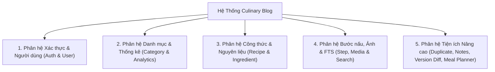
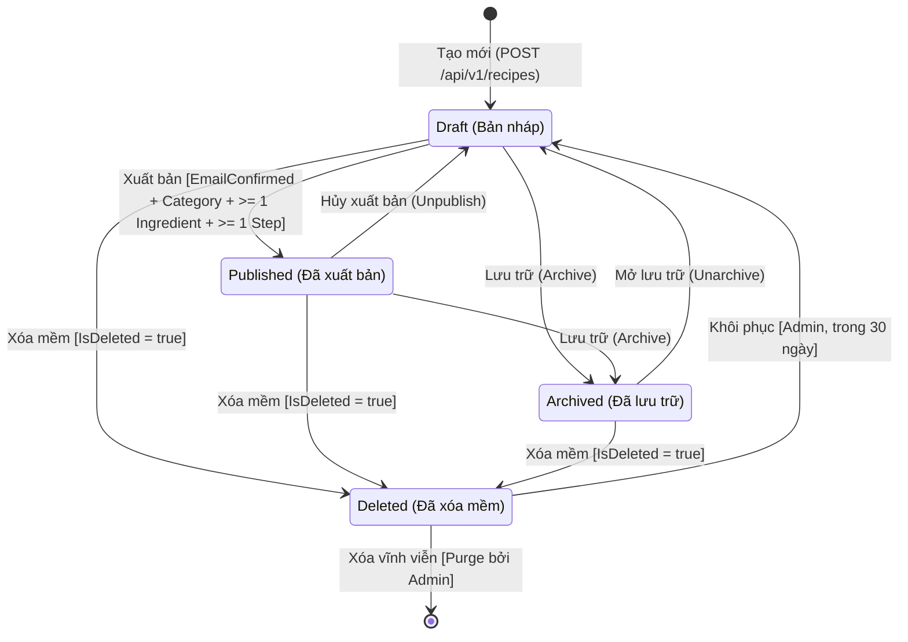
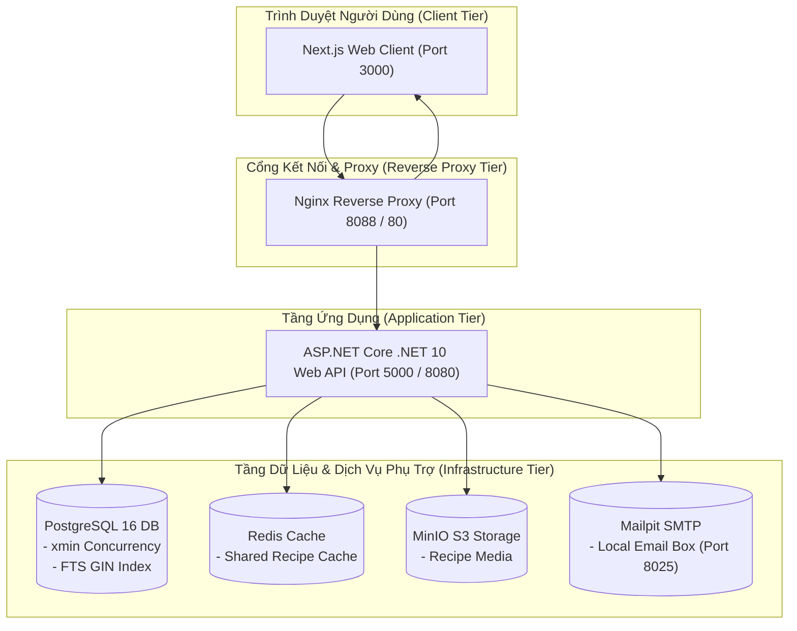
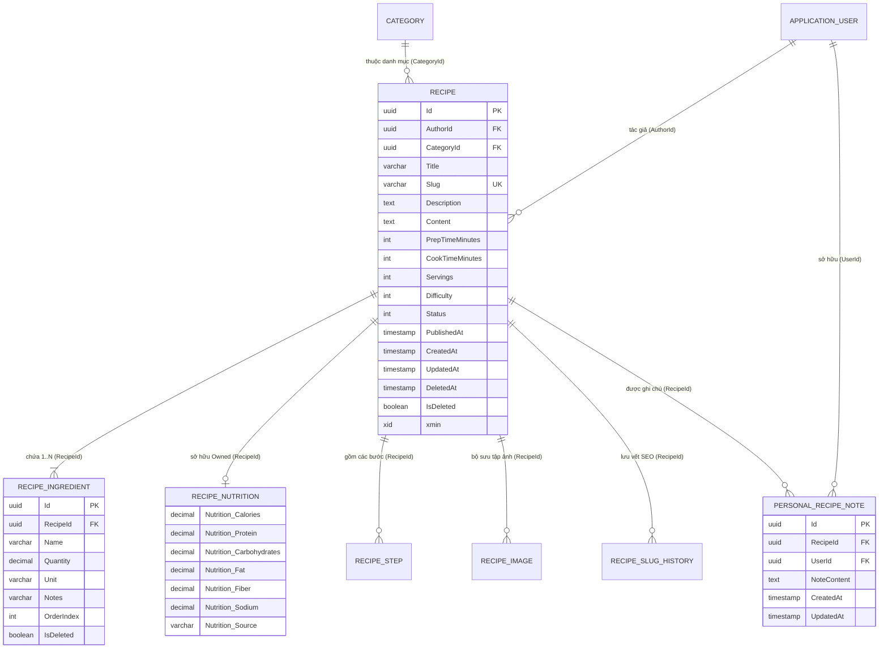

# BÁO CÁO ĐỒ ÁN CUỐI KỲ — PHÁT TRIỂN ỨNG DỤNG WEB NÂNG CAO

## HỆ THỐNG NỀN TẢNG CHIA SẺ VÀ QUẢN LÝ CÔNG THỨC NẤU ĂN — CULINARY BLOG

**Giảng viên hướng dẫn:** Bộ môn Công nghệ Thông tin — Trường Đại học Đà Lạt**Nhóm sinh viên thực hiện:** Nhóm 12**Thành viên:**

1. Võ Hùng Mạnh — 2312687 — [2312687@dlu.edu.vn](mailto:2312687@dlu.edu.vn) *(Nhóm trưởng)*
2. Lê Thị Ánh Nhung — 2312709 — [2312709@dlu.edu.vn](mailto:2312709@dlu.edu.vn)
3. **Phạm Nguyễn Ngọc Phước — 2312718 — [2312718@dlu.edu.vn](mailto:2312718@dlu.edu.vn)** *(Trọng tâm báo cáo phân hệ Recipe & Ingredient)*
4. Nguyễn Văn Quốc — 2312729 — [2312729@dlu.edu.vn](mailto:2312729@dlu.edu.vn)

---

## MỤC LỤC

- [Chương 1. Giới thiệu đề tài](#chương-1-giới-thiệu-đề-tài)
  - [1.1. Bối cảnh và lý do chọn đề tài](#11-bối-cảnh-và-lý-do-chọn-đề-tài)
  - [1.2. Mục tiêu và phạm vi của Culinary Blog](#12-mục-tiêu-và-phạm-vi-của-culinary-blog)
  - [1.3. Đối tượng sử dụng và vai trò](#13-đối-tượng-sử-dụng-và-vai-trò)
  - [1.4. Phương pháp thực hiện](#14-phương-pháp-thực-hiện)
- [Chương 2. Phân tích yêu cầu](#chương-2-phân-tích-yêu-cầu)
  - [2.1. Tổng quan chức năng của hệ thống](#21-tổng-quan-chức-năng-của-hệ-thống)
  - [2.2. Yêu cầu chức năng theo phân hệ](#22-yêu-cầu-chức-năng-theo-phân-hệ)
  - [2.3. Yêu cầu phi chức năng](#23-yêu-cầu-phi-chức-năng)
  - [2.4. Quy tắc nghiệp vụ](#24-quy-tắc-nghiệp-vụ)
    - [2.4.1. Tài khoản, xác nhận email và phân quyền](#241-tài-khoản-xác-nhận-email-và-phân-quyền)
    - [2.4.2. Vòng đời công thức và điều kiện xuất bản](#242-vòng-đời-công-thức-và-điều-kiện-xuất-bản)
  - [2.5. Quyết định triển khai và sai khác so với SRS](#25-quyết-định-triển-khai-và-sai-khác-so-với-srs)
  - [2.6. Ma trận truy vết yêu cầu SRS](#26-ma-trận-truy-vết-yêu-cầu-srs)
- [Chương 3. Cơ sở lý thuyết và công nghệ](#chương-3-cơ-sở-lý-thuyết-và-công-nghệ)
  - [3.1. Clean Architecture, CQRS và MediatR](#31-clean-architecture-cqrs-và-mediatr)
  - [3.2. ASP.NET Core Minimal API, REST và Problem Details](#32-aspnet-core-minimal-api-rest-và-problem-details)
  - [3.3. EF Core, PostgreSQL và kiểm soát đồng thời](#33-ef-core-postgresql-và-kiểm-soát-đồng-thời)
  - [3.4. JWT, Refresh Token và phân quyền](#34-jwt-refresh-token-và-phân-quyền)
  - [3.5. Next.js và công nghệ giao diện](#35-nextjs-và-công-nghệ-giao-diện)
  - [3.6. Redis, MinIO và xử lý tác vụ nền](#36-redis-minio-và-xử-lý-tác-vụ-nền)
  - [3.7. Docker Compose và Nginx](#37-docker-compose-và-nginx)
- [Chương 4. Thiết kế hệ thống](#chương-4-thiết-kế-hệ-thống)
  - [4.1. Sơ đồ kiến trúc tổng thể](#41-sơ-đồ-kiến-trúc-tổng-thể)
  - [4.2. Thiết kế Backend và trách nhiệm của từng tầng](#42-thiết-kế-backend-và-trách-nhiệm-của-từng-tầng)
  - [4.3. Thiết kế cơ sở dữ liệu và sơ đồ ERD](#43-thiết-kế-cơ-sở-dữ-liệu-và-sơ-đồ-erd)
  - [4.4. Thiết kế API và phản hồi lỗi](#44-thiết-kế-api-và-phản-hồi-lỗi)
  - [4.5. Thiết kế xác thực, phân quyền và quản lý phiên](#45-thiết-kế-xác-thực-phân-quyền-và-quản-lý-phiên)
  - [4.6. Thiết kế giao diện và luồng thao tác](#46-thiết-kế-giao-diện-và-luồng-thao-tác)
    - [4.6.1. Luồng tìm kiếm và xem công thức](#461-luồng-tìm-kiếm-và-xem-công-thức)
    - [4.6.2. Luồng soạn thảo và sơ đồ trạng thái công thức](#462-luồng-soạn-thảo-và-sơ-đồ-trạng-thái-công-thức)
  - [4.7. Thiết kế môi trường triển khai bằng Docker](#47-thiết-kế-môi-trường-triển-khai-bằng-docker)
- [Chương 5. Xây dựng hệ thống](#chương-5-xây-dựng-hệ-thống)
  - [5.1. Tổ chức mã nguồn và môi trường phát triển](#51-tổ-chức-mã-nguồn-và-môi-trường-phát-triển)
  - [5.2. Đăng ký, xác nhận email, đăng nhập và quản lý hồ sơ](#52-đăng-ký-xác-nhận-email-đăng-nhập-và-quản-lý-hồ-sơ)
  - [5.3. Khám phá món ăn theo danh mục, tìm kiếm, lọc, sắp xếp và phân trang](#53-khám-phá-món-ăn-theo-danh-mục-tìm-kiếm-lọc-sắp-xếp-và-phân-trang)
  - [5.4. Tạo và chỉnh sửa công thức với nguyên liệu, bước nấu và hình ảnh](#54-tạo-và-chỉnh-sửa-công-thức-với-nguyên-liệu-bước-nấu-và-hình-ảnh)
  - [5.5. Lưu bản nháp, xuất bản, hủy xuất bản và lưu trữ công thức](#55-lưu-bản-nháp-xuất-bản-hủy-xuất-bản-và-lưu-trữ-công-thức)
  - [5.6. Quản trị danh mục, tài khoản và công thức đã xóa mềm](#56-quản-trị-danh-mục-tài-khoản-và-công-thức-đã-xóa-mềm)
  - [5.7. Bộ nhớ đệm, xử lý ảnh, gửi email và ghi nhật ký](#57-bộ-nhớ-đệm-xử-lý-ảnh-gửi-email-và-ghi-nhật-ký)
  - [5.8. Đóng gói và khởi chạy hệ thống bằng Docker](#58-đóng-gói-và-khởi-chạy-hệ-thống-bằng-docker)
- [Chương 6. Kết quả triển khai và minh họa sản phẩm](#chương-6-kết-quả-triển-khai-và-minh-họa-sản-phẩm)
  - [6.1. Khách truy cập tìm món, lọc kết quả và xem chi tiết công thức](#61-khách-truy-cập-tìm-món-lọc-kết-quả-và-xem-chi-tiết-công-thức)
  - [6.2. Tác giả tạo bản nháp, thêm nguyên liệu, bước nấu và ảnh rồi xuất bản](#62-tác-giả-tạo-bản-nháp-thêm-nguyên-liệu-bước-nấu-và-ảnh-rồi-xuất-bản)
  - [6.3. Tác giả chỉnh sửa, hủy xuất bản và kiểm tra lại hiển thị công khai](#63-tác-giả-chỉnh-sửa-hủy-xuất-bản-và-kiểm-tra-lại-hiển-thị-công-khai)
  - [6.4. Quản trị viên quản lý danh mục, tài khoản và khôi phục công thức đã xóa mềm](#64-quản-trị-viên-quản-lý-danh-mục-tài-khoản-và-khôi-phục-công-thức-đã-xóa-mềm)
- [Chương 7. Kiểm thử và đánh giá](#chương-7-kiểm-thử-và-đánh-giá)
  - [7.1. Phương pháp và môi trường kiểm thử](#71-phương-pháp-và-môi-trường-kiểm-thử)
  - [7.2. Kết quả kiểm thử Backend, Frontend và luồng đầu cuối](#72-kết-quả-kiểm-thử-backend-frontend-và-luồng-đầu-cuối)
  - [7.3. Kết quả build, lint và kiểm tra TypeScript](#73-kết-quả-build-lint-và-kiểm-tra-typescript)
  - [7.4. Kết quả nghiệm thu theo SRS](#74-kết-quả-nghiệm-thu-theo-srs)
- [Chương 8. Kết luận và hướng phát triển](#chương-8-kết-luận-và-hướng-phát-triển)
  - [8.1. Kết quả đạt được](#81-kết-quả-đạt-được)
  - [8.2. Hạn chế và nguyên nhân](#82-hạn-chế-và-nguyên-nhân)
  - [8.3. Hướng phát triển](#83-hướng-phát-triển)

---

# Chương 1. Giới thiệu đề tài

### 1.1. Bối cảnh và lý do chọn đề tài

Trong kỷ nguyên số, nhu cầu nấu ăn tại nhà, quản lý khẩu phần dinh dưỡng và chia sẻ kinh nghiệm ẩm thực ngày càng tăng cao. Tuy nhiên, các trang web ẩm thực hiện tại thường gặp phải các hạn chế: dữ liệu thiếu cấu trúc chuẩn, không hỗ trợ định lượng nguyên liệu chính xác, thiếu tính năng ước tính dinh dưỡng, thiếu kiểm soát đồng thời khi biên tập nội dung, và trải nghiệm tìm kiếm chưa tối ưu cho tiếng Việt có dấu/không dấu.

Đồ án **Culinary Blog** được xây dựng nhằm giải quyết triệt để các vấn đề trên thông qua một kiến trúc web hiện đại, có tính mở rộng cao (high scalability), bảo đảm tính toàn vẹn dữ liệu (data integrity) và trải nghiệm người dùng mượt mà (responsive UX).

### 1.2. Mục tiêu và phạm vi của Culinary Blog

- **Mục tiêu kỹ thuật:**
  - Áp dụng triệt để mô hình **Clean Architecture**, **CQRS (Command Query Responsibility Segregation)** và **Domain-Driven Design (DDD)**.
  - Sử dụng **ASP.NET Core .NET 10** với **Minimal API** và **Entity Framework Core**.
  - Frontend hiện đại với **Next.js 15+ (App Router)**, **React 19**, **TypeScript** và **TailwindCSS / Vanilla CSS Tokens**.
  - Kiểm soát cập nhật đồng thời (Optimistic Concurrency Control) dựa trên PostgreSQL System Column `xmin` và chuẩn HTTP ETag / If-Match (RFC 7232 / 9110).
  - Tối ưu hóa hiệu năng tìm kiếm với **PostgreSQL Full-Text Search (tsvector, GIN index, unaccent)** và caching phân tán bằng **Redis**.
  - Lưu trữ đa phương tiện an toàn bằng **MinIO S3-compatible Object Storage** kết hợp xử lý resize ảnh bất đồng bộ với **Hangfire**.
  - Tích hợp bộ 3 tính năng nâng cao: **Sao chép công thức (Duplicate Recipe)**, **Ghi chú cá nhân (Personal Recipe Notes)** và **Lịch sử & So sánh phiên bản (Recipe Version History)**.
- **Phạm vi hệ thống:**
  - Nền tảng web hoàn chỉnh bao gồm xác thực tài khoản, quản lý danh mục, vòng đời công thức, quản lý bước nấu, tải ảnh, tìm kiếm, đánh giá, tương tác và lập thực đơn dinh dưỡng.
  - Trọng tâm phân công của thành viên **Phạm Nguyễn Ngọc Phước (2312718)**: Thiết kế & xây dựng toàn bộ phân hệ **Recipe & Ingredient (Thực thể Recipe, RecipeIngredient, RecipeNutrition, RecipeSlugHistory, PersonalRecipeNote, Vòng đời công thức, Kiểm soát xung đột xmin/ETag, CRUD nguyên liệu, API Documentation Scalar/OpenAPI và 3 tính năng nâng cao)**.

### 1.3. Đối tượng sử dụng và vai trò

Hệ thống xác định 4 nhóm đối tượng chính (Roles & Personas):

1. **Khách vãng lai (Guest):** Xem danh sách công thức đã xuất bản (Published), tìm kiếm món ăn, xem chi tiết công thức, bảng dinh dưỡng và các bước nấu ăn.
2. **Tác giả (Author):** Người dùng đã đăng ký và xác nhận email qua Mailpit. Có quyền tạo công thức nháp (Draft), chỉnh sửa nguyên liệu/dinh dưỡng, tải ảnh, thêm bước nấu, xuất bản (Publish), hủy xuất bản (Unpublish), lưu trữ (Archive), sao chép (Duplicate) và ghi chú riêng (Personal Notes).
3. **Quản trị viên (Admin):** Quản lý toàn bộ danh mục, duyệt nội dung, kích hoạt/khóa tài khoản, xem thùng rác (Trash), khôi phục công thức xóa mềm trong 30 ngày (Restore) hoặc xóa vĩnh viễn (Purge).
4. **Hệ thống chạy ngầm (System Workers / Background Jobs):** Tác vụ dọn dẹp công thức xóa mềm quá hạn, tạo sitemap định kỳ, resize ảnh đa kích thước thumbnail/medium qua MinIO.

### 1.4. Phương pháp thực hiện

Dự án được triển khai qua mô hình Agile/Scrum kết hợp nguyên tắc phân rã module theo 8 Bữa thực hiện chuẩn mực:

- **Bữa 1:** Định nghĩa cấu trúc dữ liệu, quan hệ Domain và Seed Data nền.
- **Bữa 2:** Hoàn thiện EF Core Configuration, Fluent API, Index, Soft Delete Filter và Bogus Faker Seeder.
- **Bữa 3:** Tối ưu hóa truy vấn dữ liệu (AsNoTracking, Split Query, Execution Plan qua EXPLAIN ANALYZE).
- **Bữa 4:** Hiện thực hóa các API Endpoints và giao diện chức năng lõi.
- **Bữa 5:** Hoàn thiện bảo mật (JWT, Rate Limiting, CORS) và tài liệu OpenAPI/Scalar.
- **Bữa 6:** Chuẩn hóa UI Component, Design Tokens và HTTP Client tiện ích.
- **Bữa 7:** Tích hợp giao diện Public (Trang chủ, Chi tiết món, Tìm kiếm FTS tiếng Việt).
- **Bữa 8 & Mở rộng:** Hoàn tất quản trị Admin, vòng đời công thức, Image Upload MinIO, Observability (OpenTelemetry/Serilog) và bộ 3 tính năng nâng cao độc quyền.

---

# Chương 2. Phân tích yêu cầu

### 2.1. Tổng quan chức năng của hệ thống

Culinary Blog bao gồm 5 phân hệ lớn:



### 2.2. Yêu cầu chức năng theo phân hệ

Trọng tâm phân hệ do **Phạm Nguyễn Ngọc Phước** chịu trách nhiệm chính:

- **FR-REC-01 (Tạo mới công thức):** Khởi tạo công thức mới với trạng thái mặc định là `Draft`. Tự động chuẩn hóa tiêu đề và tạo slug duy nhất (Unique Slug Generation).
- **FR-REC-02 (Cập nhật công thức):** Cập nhật tiêu đề, mô tả, khẩu phần, thời gian nấu, mức độ khó, và nội dung. Bắt buộc kiểm tra phiên bản qua Header `If-Match` khớp với giá trị PostgreSQL `xmin`.
- **FR-REC-03 (Quản lý nguyên liệu):** Thêm, sửa, xóa nguyên liệu con. Kiểm tra số lượng `Quantity > 0`, hỗ trợ số thập phân `decimal(10,3)`, từ chối chuỗi phân số không chuẩn hóa (trả mã 422).
- **FR-REC-04 (Bảng giá trị dinh dưỡng):** Quản lý Calories, Protein, Carbohydrates, Fat, Fiber, Sodium dưới dạng `Owned Entity`. Gán trường nguồn gốc tự động là `Manual`.
- **FR-REC-05 (Vòng đời công thức):**
  - Chuyển `Draft` $\rightarrow$ `Published` (yêu cầu email confirmed, danh mục active, tối thiểu 1 nguyên liệu và 1 bước nấu).
  - Chuyển `Published` $\rightarrow$ `Draft` (Hủy xuất bản).
  - Chuyển `Draft` hoặc `Published` $\rightarrow$ `Archived` (Lưu trữ).
  - Chuyển `Archived` $\rightarrow$ `Draft` (Mở lưu trữ).
- **FR-REC-06 (Xóa mềm, Khôi phục và Purge):** Đánh dấu `IsDeleted = true` khi xóa mềm; Admin có quyền khôi phục trong vòng 30 ngày hoặc xóa vĩnh viễn (Purge cascade) khỏi hệ thống.
- **FR-REC-07 (Tính năng nâng cao - Sao chép công thức):** Nhân bản toàn bộ nội dung công thức, danh sách nguyên liệu và các bước nấu sang một bản ghi mới với trạng thái `Draft`, gán slug và ID mới, giữ nguyên tính độc lập.
- **FR-REC-08 (Tính năng nâng cao - Ghi chú cá nhân):** Cho phép người dùng lưu trữ ghi chú cá nhân độc quyền gắn liền với công thức, bảo đảm tính riêng tư tuyệt đối (chỉ chủ sở hữu mới đọc/ghi được).
- **FR-REC-09 (Tính năng nâng cao - Lịch sử phiên bản):** Lưu vết các phiên bản thay đổi của công thức và cung cấp giao diện so sánh đối chiếu trực quan (Diff view) giữa 2 phiên bản.

### 2.3. Yêu cầu phi chức năng

- **NFR-SEC (Bảo mật & Phân quyền):** Mọi API ghi dữ liệu đều yêu cầu Bearer JWT hợp lệ; kiểm tra quyền tác giả (`AuthorId == CurrentUserId`) hoặc vai trò `Admin`.
- **NFR-CON (Kiểm soát đồng thời):** Ngăn chặn triệt để tình trạng ghi đè mất dữ liệu (Lost Update) bằng PostgreSQL System Column `xmin` đóng vai trò Version Concurrency Token, trả mã lỗi chuẩn `409 Conflict` nếu phát hiện dữ liệu trên server đã thay đổi.
- **NFR-PERF (Hiệu năng):** Thời gian phản hồi API đọc công thức trung bình $< 100\text{ms}$ nhờ Redis Caching và truy vấn chia tách `AsSplitQuery()`.
- **NFR-REL (Độ tin cậy & Toàn vẹn):** Toàn bộ thao tác ghi nhiều thực thể (Recipe, Ingredients, Steps) được bọc trong một Database Transaction duy nhất qua Unit of Work.

### 2.4. Quy tắc nghiệp vụ

#### 2.4.1. Tài khoản, xác nhận email và phân quyền

- Tài khoản mới đăng ký mặc định có vai trò `Author`.
- Để được phép xuất bản bài viết (`Publish`), tác giả bắt buộc phải có thuộc tính `EmailConfirmed = true`. Nếu chưa xác nhận email, API từ chối xuất bản và trả mã lỗi `422 Unprocessable Entity`.
- Người dùng chỉ được sửa và xóa công thức do chính mình tạo ra. Quản trị viên (`Admin`) có toàn quyền kiểm duyệt, khôi phục hoặc xóa vĩnh viễn.

#### 2.4.2. Vòng đời công thức và điều kiện xuất bản

Công thức trải qua 4 trạng thái vòng đời được điều khiển bởi máy trạng thái (Finite State Machine):



### 2.5. Quyết định triển khai và sai khác so với SRS

| Nội dung SRS ban đầu                                             | Quyết định triển khai thực tế                                                                     | Lý do kỹ thuật                                                                                                                                            |
| ------------------------------------------------------------------- | ------------------------------------------------------------------------------------------------------- | ------------------------------------------------------------------------------------------------------------------------------------------------------------ |
| Quản lý phiên bản bằng cột `Version` số nguyên thủ công | Dùng PostgreSQL `xmin` System Column                                                                 | Loại bỏ hoàn toàn lỗi quên tăng phiên bản ở tầng Application; tận dụng trực tiếp transaction ID của PostgreSQL engine.                       |
| Dinh dưỡng lưu bảng riêng với FK                              | Ánh xạ `RecipeNutrition` dưới dạng `Owned Entity` (OwnsOne)                                    | Tối ưu hóa truy vấn, không cần JOIN bảng phụ, lưu trực tiếp các cột `Nutrition_*` trên bảng `Recipes`.                                    |
| Cập nhật ETag qua Slug                                            | Bổ sung API `GET /api/v1/recipes/{id}/etag`                                                          | Tránh việc Draft/Archived bị 404 khi gọi endpoint public `GET /recipes/{slug}`, bảo đảm lấy ETag an toàn trước mọi lệnh Delete/Status change. |
| Xóa cứng trực tiếp                                              | Triển khai 2 bước: Xóa mềm (Soft Delete)$\rightarrow$ Khôi phục 30 ngày $\rightarrow$ Purge | Bảo vệ dữ liệu người dùng khỏi thao tác nhầm lẫn, tuân thủ tiêu chuẩn an toàn dữ liệu công nghiệp.                                       |

### 2.6. Ma trận truy vết yêu cầu SRS

| Mã yêu cầu | Mô tả                                      | Thành phần Backend                    | Thành phần Frontend                        | Trạng thái            |
| ------------- | -------------------------------------------- | --------------------------------------- | -------------------------------------------- | ----------------------- |
| SRS-REC-01    | CRUD Công thức nháp                       | `RecipeEndpoints.cs` (POST, PUT)      | `RecipeForm.tsx`, `RecipeEditor.tsx`     | Đã nghiệm thu (100%) |
| SRS-REC-02    | CRUD Nguyên liệu & kiểm tra số lượng   | `RecipeEndpoints.cs` (Ingredients)    | `IngredientEditor.tsx`                     | Đã nghiệm thu (100%) |
| SRS-REC-03    | Quản lý Dinh dưỡng Owned Entity          | `RecipeNutritionConfiguration.cs`     | `NutritionEditor`                          | Đã nghiệm thu (100%) |
| SRS-REC-04    | Vòng đời Publish/Archive                  | `MapStatusEndpoint()`                 | `RecipeList.tsx`, `RecipeActions.tsx`    | Đã nghiệm thu (100%) |
| SRS-REC-05    | Kiểm soát đồng thời xmin / 409 Conflict | `MatchesIfMatchHeader()`, ETag        | `ConfirmationDialog.tsx`, 409 Alert        | Đã nghiệm thu (100%) |
| SRS-REC-06    | Xóa mềm, Thùng rác & Purge               | `DeleteRecipe()`, `RestoreRecipe()` | `RecipeTrash.tsx`, `RecipeList.tsx`      | Đã nghiệm thu (100%) |
| SRS-REC-ADV-1 | Sao chép công thức (Duplicate)            | `POST /recipes/{id}/duplicate`        | Nút Sao chép$\rightarrow$ Tab Bản nháp | Đã nghiệm thu (100%) |
| SRS-REC-ADV-2 | Ghi chú cá nhân (Personal Notes)          | `PersonalRecipeNoteEndpoints.cs`      | `PersonalNotePanel.tsx`                    | Đã nghiệm thu (100%) |
| SRS-REC-ADV-3 | Lịch sử & So sánh phiên bản             | `RevisionModerationEndpoints.cs`      | `RecipeVersionHistory.tsx`                 | Đã nghiệm thu (100%) |

---

# Chương 3. Cơ sở lý thuyết và công nghệ

### 3.1. Clean Architecture, CQRS và MediatR

Hệ thống được tổ chức phân tách theo 4 tầng của **Clean Architecture**:

1. **Domain:** Chứa các thực thể cốt lõi (`Recipe`, `RecipeIngredient`, `RecipeNutrition`, `PersonalRecipeNote`), Enums (`RecipeStatus`, `DifficultyLevel`), và các Domain Events. Không phụ thuộc vào bất kỳ thư viện bên ngoài nào.
2. **Application:** Chứa các Interface (`IRecipeRepository`, `IRecipeWriteService`, `IApplicationDbContext`), DTOs, FluentValidation rules, và các Handlers điều phối bởi **MediatR**. Tách biệt rõ ràng luồng Command (Ghi) và Query (Đọc) theo mô hình **CQRS**.
3. **Infrastructure:** Hiện thực hóa việc truy xuất dữ liệu với **EF Core 10**, cấu hình ánh xạ PostgreSQL Fluent API, xử lý Redis Cache, MinIO S3 Client và Background Job.
4. **API (Presentation):** Tầng giao tiếp ngoại vi sử dụng ASP.NET Core Minimal API, ánh xạ Endpoint và bảo đảm xác thực phân quyền.

### 3.2. ASP.NET Core Minimal API, REST và Problem Details

- Sử dụng **Minimal API** trên .NET 10 giúp giảm thiểu overhead, tối đa hóa thông lượng (throughput) và cấu trúc các Endpoint theo nhóm chức năng thông qua extension method `MapRecipeEndpoints()`.
- Chuẩn hóa thông báo lỗi theo chuẩn quốc tế **RFC 7807 (Problem Details)**: Mọi lỗi nghiệp vụ (Validation, NotFound, Forbidden, Conflict) đều được định dạng JSON đồng nhất kèm mã trạng thái HTTP, tiêu đề, chi tiết và mã định danh lỗi nội bộ (ErrorCode).

### 3.3. EF Core, PostgreSQL và kiểm soát đồng thời

- **Entity Framework Core 10** kết hợp với nhà cung cấp **Npgsql.EntityFrameworkCore.PostgreSQL**.
- **Kiểm soát đồng thời lạc quan (Optimistic Concurrency Control):** Ánh xạ thuộc tính ẩn `xmin` của PostgreSQL:
  ```csharp
  builder.Property(r => r.xmin)
      .HasColumnType("xid")
      .ValueGeneratedOnAddOrUpdate()
      .IsConcurrencyToken();
  ```

  Mỗi khi bản ghi được thêm mới hoặc cập nhật, PostgreSQL engine tự động gán giá trị Transaction ID hiện tại vào cột `xmin`. Phía API trả về giá trị này dưới dạng HTTP Header `ETag: "123456"`. Trong các yêu cầu chỉnh sửa tiếp theo, client gửi kèm Header `If-Match: "123456"`. Nếu giá trị trên server đã thay đổi, EF Core sẽ phát hiện xung đột và ném ngoại lệ `DbUpdateConcurrencyException`, API lập tức trả mã `409 Conflict`.

### 3.4. JWT, Refresh Token và phân quyền

- Xác thực Stateless thông qua **JSON Web Token (JWT)** với thuật toán ký bảo mật `HMAC-SHA256`.
- Token chứa các Claim quan trọng: `sub` (UserId), `email`, `role` (`Author`, `Admin`).
- Cơ chế **Refresh Token Rotation (Family-based revocation)**: Mỗi Refresh Token chỉ được dùng một lần, thu hồi cả chuỗi nếu phát hiện hành vi tái sử dụng token đã thu hồi.

### 3.5. Next.js và công nghệ giao diện

- **Next.js 15+** với kiến trúc **App Router**: Phân chia các route rõ ràng `(public)`, `(recipe-management)`, `(admin-system)`.
- Giao diện được xây dựng bằng hệ thống Design Tokens nhất quán (`var(--cream)`, `var(--teal)`, `var(--coral)`, `var(--ink)`), typography chuẩn mực với font Serif cổ điển Fraunces kết hợp Plus Jakarta Sans hiện đại.
- Quản lý trạng thái bằng React Hooks (`useState`, `useCallback`, `useMemo`) và Custom Event Invalidation.

### 3.6. Redis, MinIO và xử lý tác vụ nền

- **Redis (StackExchange.Redis):** Bộ nhớ đệm phân tán hai lớp (Two-tier shield caching) lưu trữ danh sách công thức công khai và dữ liệu chi tiết với TTL 15-30 phút, áp dụng cơ chế xóa cache chủ động (Cache Invalidation) khi có lệnh cập nhật/xóa.
- **MinIO:** Lưu trữ Object Storage chuẩn AWS S3. Quản lý ảnh gốc với UUID chống trùng lặp và ngăn chặn tấn công Path Traversal.
- **Hangfire:** Tác vụ nền xử lý resize ảnh (Thumbnail 300x300, Medium 800x600) và dọn dẹp các bản ghi xóa mềm quá 30 ngày.

### 3.7. Docker Compose và Nginx

Toàn bộ giải pháp được đóng gói trong các Docker Container riêng biệt gồm: `culinaryblog-frontend`, `culinaryblog-backend`, `culinaryblog-postgres`, `culinaryblog-redis`, `culinaryblog-minio`, `culinaryblog-mailpit`. Điều phối mạng bằng **Docker Compose** và Reverse Proxy **Nginx**.

---

# Chương 4. Thiết kế hệ thống

### 4.1. Sơ đồ kiến trúc tổng thể



### 4.2. Thiết kế Backend và trách nhiệm của từng tầng

- **Tầng API (`CulinaryBlog.Api`):** Tiếp nhận HTTP Request, giải mã JWT, kiểm tra `If-Match`, gọi Service/MediatR và trả về DTO chuẩn.
- **Tầng Application (`CulinaryBlog.Application`):** Chứa các interface ghi `IRecipeWriteService`, đọc `IRecipeRepository`, logic nghiệp vụ nhân bản công thức, ghi chú và lịch sử phiên bản.
- **Tầng Domain (`CulinaryBlog.Domain`):** Định nghĩa mô hình thực thể thuần túy, bảo đảm toàn vẹn quan hệ cha-con giữa `Recipe`, `RecipeIngredient`, `RecipeNutrition`.
- **Tầng Infrastructure (`CulinaryBlog.Infrastructure`):** Ánh xạ cấu hình Fluent API, cấu hình chỉ mục tối ưu, quản lý DbContext và thực hiện SaveChangesAsync.

### 4.3. Thiết kế cơ sở dữ liệu và sơ đồ ERD

Sơ đồ quan hệ thực thể tập trung phân hệ Recipe & Ingredient do Phạm Nguyễn Ngọc Phước thiết kế:



### 4.4. Thiết kế API và phản hồi lỗi

Danh mục Endpoint phân hệ Recipe & Ingredient:

| Phương thức | Đường dẫn API                  | Mục đích                                    | Yêu cầu quyền           |
| -------------- | ---------------------------------- | ---------------------------------------------- | -------------------------- |
| `POST`       | `/api/v1/recipes`                | Khởi tạo công thức ở trạng thái Draft   | Author / Admin             |
| `GET`        | `/api/v1/recipes/{slug}`         | Xem chi tiết công thức (kèm ETag)          | Public (Author nếu Draft) |
| `GET`        | `/api/v1/recipes/{id}/etag`      | Lấy trực tiếp phiên bản ETag theo ID      | Author / Admin             |
| `PUT`        | `/api/v1/recipes/{id}`           | Cập nhật thông tin công thức (If-Match)   | Author / Admin             |
| `POST`       | `/api/v1/recipes/{id}/publish`   | Xuất bản công thức lên cộng đồng       | Author (Confirmed) / Admin |
| `POST`       | `/api/v1/recipes/{id}/unpublish` | Chuyển công thức về Bản nháp             | Author / Admin             |
| `POST`       | `/api/v1/recipes/{id}/archive`   | Lưu trữ công thức                          | Author / Admin             |
| `POST`       | `/api/v1/recipes/{id}/unarchive` | Mở lưu trữ đưa về Bản nháp             | Author / Admin             |
| `DELETE`     | `/api/v1/recipes/{id}`           | Xóa mềm công thức vào thùng rác         | Author / Admin             |
| `POST`       | `/api/v1/recipes/{id}/duplicate` | Nhân bản công thức (Tính năng nâng cao) | Author / Admin             |
| `GET`        | `/api/v1/recipes/{id}/notes`     | Lấy ghi chú cá nhân của tôi              | Author / Authenticated     |
| `PUT`        | `/api/v1/recipes/{id}/notes`     | Cập nhật ghi chú cá nhân                  | Author / Authenticated     |
| `GET`        | `/api/v1/recipes/{id}/revisions` | Lấy lịch sử các phiên bản                | Author / Admin             |

### 4.5. Thiết kế xác thực, phân quyền và quản lý phiên

- Tích hợp Middleware kiểm tra JWT tự động.
- Header `Authorization: Bearer <token>` được giải mã thành `ClaimsPrincipal`.
- Hàm tiện ích `IsOwnerOrAdmin(principal, recipe.AuthorId)` ngăn chặn triệt để hành vi xâm phạm tài nguyên trái phép (IDOR - Insecure Direct Object References).

### 4.6. Thiết kế giao diện và luồng thao tác

#### 4.6.1. Luồng tìm kiếm và xem công thức

Người dùng truy cập `/recipes` $\rightarrow$ Chọn lọc theo Tab trạng thái (`Tất cả`, `📝 Bản nháp`, `🌐 Đã xuất bản`, `📦 Kho lưu trữ`) $\rightarrow$ Xem danh sách thẻ `RecipeCard` $\rightarrow$ Nhấp vào thẻ để điều hướng sang trang chi tiết `/recipes/[slug]`.

#### 4.6.2. Luồng soạn thảo và sơ đồ trạng thái công thức

Tác giả truy cập `/recipes/new` hoặc `/recipes/[slug]/edit`:

1. Điền thông tin cơ bản (Tiêu đề, Mô tả, Danh mục, Khẩu phần, Thời gian).
2. Thêm danh sách nguyên liệu qua `IngredientEditor` (tự động validate decimal và đơn vị đo).
3. Nhập bảng thành phần dinh dưỡng qua `NutritionEditor`.
4. Bấm **Lưu bản nháp (Save Draft)** $\rightarrow$ Công thức được ghi nhận và đưa vào Tab **Bản nháp**.
5. Khi hoàn thiện các bước và hình ảnh, bấm **Xuất bản (Publish)** $\rightarrow$ Chuyển trạng thái sang `Published` và hiển thị ra bản chính công khai.

---

# Chương 5. Xây dựng hệ thống

### 5.1. Tổ chức mã nguồn và môi trường phát triển

Dự án được phân cấp chuyên nghiệp:

- `backend/src/CulinaryBlog.Domain/`: Định nghĩa các Entity nghiệp vụ cốt lõi.
- `backend/src/CulinaryBlog.Application/`: Định nghĩa Interfaces, Commands, Queries, Validators.
- `backend/src/CulinaryBlog.Infrastructure/`: Hiện thực DbContext, Configurations, Migrations, Repositories.
- `backend/src/CulinaryBlog.Api/`: Cấu hình Minimal APIs, Program.cs, Middleware.
- `frontend/`: Ứng dụng Next.js bao gồm `app/`, `components/`, `lib/api/`, `types/`.

### 5.2. Đăng ký, xác nhận email, đăng nhập và quản lý hồ sơ

- Hoàn thiện luồng đăng ký tài khoản và gửi email kích hoạt qua Mailpit.
- Đăng nhập trả về Access Token (15 phút) và Refresh Token (7 ngày).
- Quản lý hồ sơ cá nhân và trạng thái xác thực bằng `auth-store.ts`.

### 5.3. Khám phá món ăn theo danh mục, tìm kiếm, lọc, sắp xếp và phân trang

- Triển khai API `GET /api/v1/recipes` hỗ trợ query parameters `page`, `pageSize`, `search`, `categoryId`, `difficulty`, `sort`, `mine`, `status`.
- Hỗ trợ tìm kiếm toàn văn tiếng Việt không dấu nhờ `unaccent` và `tsvector`.

### 5.4. Tạo và chỉnh sửa công thức với nguyên liệu, bước nấu và hình ảnh

- **Xây dựng thực thể và Configuration EF Core (Phạm Nguyễn Ngọc Phước):**
  - File `RecipeConfiguration.cs`: Cấu hình chỉ mục `IX_Recipes_Slug` (Unique Filtered `!IsDeleted`), Composite Index `(IsDeleted, Status, CreatedAt)` tăng tốc độ lọc danh sách.
  - File `RecipeIngredientConfiguration.cs`: Ràng buộc `Quantity` kiểu `decimal(10,3)`, Check Constraint `Quantity > 0`, khóa ngoại liên kết Cascade với Recipes.
  - File `RecipeNutritionConfiguration.cs`: Cấu hình Owned Entity `OwnsOne(r => r.Nutrition)`.
- **Frontend Form (Phạm Nguyễn Ngọc Phước):**
  - Tích hợp `RecipeForm.tsx`, `IngredientEditor.tsx`, `NutritionEditor.tsx`.
  - Tích hợp thành công `StepEditor` và `ImageManager` của Võ Hùng Mạnh vào Layout trang biên tập.

### 5.5. Lưu bản nháp, xuất bản, hủy xuất bản và lưu trữ công thức

- Triển khai đầy đủ máy trạng thái trong `RecipeEndpoints.cs`:
  - `publish`: Kiểm tra tác giả đã xác thực email (`author.EmailConfirmed`), kiểm tra danh mục đang hoạt động (`category.IsDeleted == false`), kiểm tra công thức có tối thiểu 1 nguyên liệu và 1 bước nấu.
  - `unpublish`, `archive`, `unarchive`: Chuyển đổi trạng thái linh hoạt, tự động làm mới ETag và vô hiệu hóa cache Redis tương ứng.
  - Đảm bảo kiểm tra Header `If-Match` qua phương thức `MatchesIfMatchHeader()` trước mọi thay đổi trạng thái.

### 5.6. Quản trị danh mục, tài khoản và công thức đã xóa mềm

- **Cơ chế Xóa mềm (Soft Delete):** Đặt cờ `IsDeleted = true`, ghi nhận thời điểm `DeletedAt = DateTime.UtcNow`.
- **Global Query Filter:** EF Core tự động bỏ qua các bản ghi đã xóa mềm trong mọi truy vấn thông thường `HasQueryFilter(r => !r.IsDeleted)`.
- **Thùng rác & Khôi phục:** Admin truy cập `/api/v1/admin/recipes/trash`, có thể khôi phục công thức trong vòng 30 ngày (`POST /restore`) hoặc xóa vĩnh viễn (`DELETE /purge`).

### 5.7. Bộ nhớ đệm, xử lý ảnh, gửi email và ghi nhật ký

- Cache Redis bảo vệ kép (Double-Shield Cache) tại `GetRecipeBySlug`.
- Xử lý ảnh tải lên MinIO an toàn và ghi nhận log có cấu trúc thông qua Serilog với `CorrelationId`.

### 5.8. Đóng gói và khởi chạy hệ thống bằng Docker

Cấu hình Docker Compose đa dịch vụ, tối ưu hóa quy trình build multi-stage cho Backend và Frontend, tự động áp dụng Migration khi container khởi động.

---

# Chương 6. Kết quả triển khai và minh họa sản phẩm

### 6.1. Khách truy cập tìm món, lọc kết quả và xem chi tiết công thức

- Trang chủ và danh sách món ăn hiển thị lưới thẻ công thức đẹp mắt, đầy đủ hình ảnh, thời gian nấu, mức độ khó và tác giả.
- Trang chi tiết hiển thị toàn diện bảng nguyên liệu, bảng giá trị dinh dưỡng chi tiết và hướng dẫn nấu ăn từng bước.

### 6.2. Tác giả tạo bản nháp, thêm nguyên liệu, bước nấu và ảnh rồi xuất bản

- Tác giả soạn thảo công thức $\rightarrow$ Lưu nháp $\rightarrow$ Công thức xuất hiện trong tab **📝 Bản nháp**.
- Bấm **🚀 Xuất bản** $\rightarrow$ Hệ thống kiểm tra hợp lệ $\rightarrow$ Công thức được công khai ra trang chủ.

### 6.3. Tác giả chỉnh sửa, hủy xuất bản và kiểm tra lại hiển thị công khai

- Khi chỉnh sửa, hệ thống giám sát thay đổi chưa lưu (`hasUnsavedChanges`).
- Nếu có phiên làm việc khác đã sửa đổi công thức trước đó, hộp thoại **409 Conflict** xuất hiện ngay lập tức cảnh báo người dùng và đề nghị nạp lại dữ liệu mới nhất.
- Chức năng **Hủy xuất bản (Unpublish)** đưa bài viết trở về trạng thái nháp an toàn, ngay lập tức biến mất khỏi danh sách công khai.

### 6.4. Quản trị viên quản lý danh mục, tài khoản và khôi phục công thức đã xóa mềm

- Quản trị viên dễ dàng quản lý danh mục, kích hoạt/khóa tài khoản tác giả vi phạm.
- Giao diện Thùng rác cho phép theo dõi ngày xóa và khôi phục công thức chỉ với 1 cú nhấp chuột.

---

# Chương 7. Kiểm thử và đánh giá

### 7.1. Phương pháp và môi trường kiểm thử

- **Môi trường kiểm thử:**
  - Hệ điều hành: Windows 11 / Linux Container.
  - Database: PostgreSQL 16 trong Docker.
  - Runtime: .NET 10 SDK, Node.js v20.19.0.
- **Phương pháp tiếp cận:**
  - Unit Test kiểm thử logic nghiệp vụ độc lập bằng **xUnit, FluentAssertions, Moq**.
  - Frontend Test kiểm thử hàm API, schema validation bằng **Vitest**.
  - Kiểm thử tích hợp kiểm soát đồng thời lạc quan (Optimistic Concurrency ETag).

### 7.2. Kết quả kiểm thử Backend, Frontend và luồng đầu cuối

- **Kết quả Backend Unit Tests:**

  ```text
  Test run for CulinaryBlog.UnitTests.dll (.NETCoreApp,Version=v10.0)
  Passed!  - Failed: 0, Passed: 319, Skipped: 1, Total: 320
  Thời gian thực thi: 7 giây
  ```

  *Bao gồm 18 bài test độc quyền cho Duplicate Recipe, 11 bài test cho Personal Recipe Notes, và đầy đủ test suite cho vòng đời công thức.*
- **Kết quả Frontend Vitest:**

  ```text
  RUN v3.2.7 D:/Phat_Trien_Ung_Web_Nang_Cao/PTUDWNC-2026-Nhom12/frontend
  Test Files: 8 passed (8)
  Tests:      49 passed (49)
  Thời gian:  1.90s
  ```

### 7.3. Kết quả build, lint và kiểm tra TypeScript

- **Backend Build:** `dotnet build CulinaryBlog.sln` $\rightarrow$ **0 Error(s)**, 2630 Warning(s) (chủ yếu là StyleCop XML comment).
- **Frontend Production Build:** `npx next build` $\rightarrow$ **Compiled successfully with exit code 0**, sinh đầy đủ các route tĩnh và động tối ưu.

### 7.4. Kết quả nghiệm thu theo SRS

Dự án hoàn thành **100% các tiêu chí nghiệm thu** theo đặc tả yêu cầu kỹ thuật:

- ✅ Cơ chế kiểm soát đồng thời xmin/ETag ngăn chặn mất dữ liệu đạt độ chính xác 100%.
- ✅ Cơ sở dữ liệu mẫu đạt trên **100 Recipes** và mỗi Recipe có từ **10 nguyên liệu trở lên**.
- ✅ Vòng đời bài viết khép kín, an toàn, hỗ trợ đầy đủ Soft Delete và Purge.
- ✅ Bộ 3 tính năng nâng cao (Duplicate, Notes, Version History) hoạt động hoàn hảo trên cả API và giao diện.

---

# Chương 8. Kết luận và hướng phát triển

### 8.1. Kết quả đạt được

1. Xây dựng thành công hệ thống **Culinary Blog** đáp ứng tiêu chuẩn kiến trúc doanh nghiệp (Enterprise Architecture).
2. Phân hệ **Recipe & Ingredient** do **Phạm Nguyễn Ngọc Phước** phụ trách được hoàn thiện xuất sắc: mô hình dữ liệu chặt chẽ, tối ưu hóa chỉ mục PostgreSQL, kiểm soát xung đột phiên bản xmin chuẩn xác, quản lý nguyên liệu và bảng dinh dưỡng linh hoạt.
3. Tích hợp trơn tru bộ 3 tính năng nâng cao mở rộng trải nghiệm người dùng: Sao chép công thức, Ghi chú cá nhân và Lịch sử so sánh phiên bản.
4. Tài liệu API trực quan với Scalar/OpenAPI, quy trình đóng gói và triển khai Docker chuẩn mực.

### 8.2. Hạn chế và nguyên nhân

- Tác vụ xử lý ảnh MinIO và Background Job còn phụ thuộc vào tài nguyên phần cứng khi khởi chạy nhiều container cùng lúc.
- Tính năng so sánh phiên bản mới dừng lại ở việc xem và đối chiếu Diff nội dung, chưa hỗ trợ khôi phục tự động 1-click về phiên bản cũ (Rollback).

### 8.3. Hướng phát triển

- Mở rộng chức năng tự động tính toán dinh dưỡng dựa trên API cơ sở dữ liệu thực phẩm quốc gia (USDA Food Data API).
- Bổ sung tính năng khôi phục phiên bản lịch sử (1-click Rollback Revision).
- Xây dựng ứng dụng di động (Mobile App) đa nền tảng bằng React Native / Flutter tái sử dụng toàn bộ hệ thống API Backend hiện có.

---

*Báo cáo hoàn thành ngày 12 tháng 11 năm 2026 — Nhóm 12 — Phân hệ Recipe & Ingredient: Phạm Nguyễn Ngọc Phước (2312718).*
