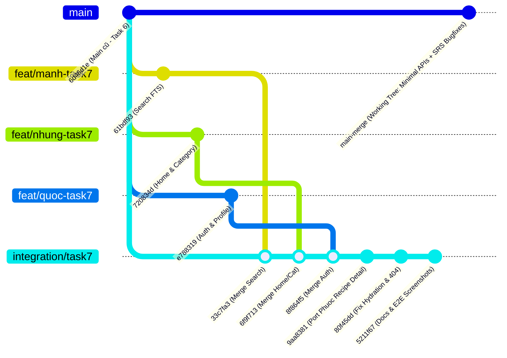
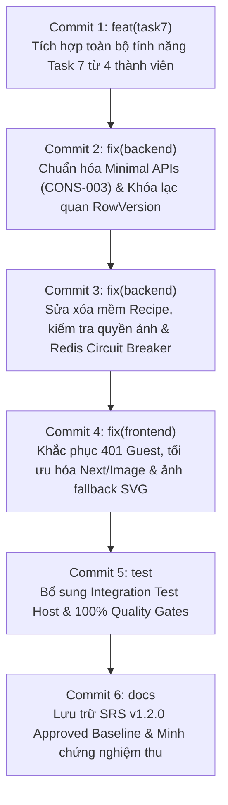

# BÁO CÁO ĐỐI CHIẾU TOÀN DIỆN MÃ NGUỒN TASK 7 VỚI MAIN CŨ VÀ CÁC NHÁNH BÀN GIAO
## (TASK 7 VS OLD MAIN & TEAM MEMBER BRANCHES TRACEABILITY AUDIT)

> **Dự án:** Culinary Blog – Phát triển Web Nâng Cao – Nhóm 12  
> **Thư mục làm việc:** `B:\bài web nhóm mới\main-merge`  
> **Nhánh hiện tại:** `main`  
> **Baseline Main cũ:** `origin/main` tại commit `6d46d1e` (*merge: integrate task 6 frontend search, image management, step editor, shared components and layout*)  
> **Tài liệu chuẩn đối chiếu:** `docs/requirements/SRS.md` – Phiên bản **1.2.0 Approved Baseline**  
> **Thời điểm kiểm toán:** 30/10/2026 13:05:00 (UTC+7)  
> **Chế độ kiểm toán:** **READ-ONLY 100%** (Tuyệt đối không `add`, không `commit`, không `push`, không `checkout`, không đổi nhánh)  

---

## I. XÁC ĐỊNH CÁC NGUỒN BÀN GIAO TASK 7 (DISCOVERY & BASELINE)

Qua quá trình kiểm tra toàn bộ lịch sử Git (`git branch -a -vv`, `git log --all`, `git merge-base`), hệ thống xác định chính xác các mốc bàn giao của 4 thành viên và nhánh tích hợp tổng:

| Thành viên / Nhánh | Tên nhánh Git chính thức | Commit SHA | Thông điệp bàn giao | Merge-base với `6d46d1e` |
| :--- | :--- | :---: | :--- | :---: |
| **Võ Hùng Mạnh** | `origin/feat/vohungmanh-task7-search` | `61bdf93` | *feat(search): hoàn thiện toàn bộ Recipe Search cho Task 7* | `6d46d1e` (Linear) |
| **Lê Thị Ánh Nhung** | `origin/2312709-LeThiAnhNhung-Home-Category-PublicLayoutIntegration` | `720834d` | *test(home-category): dong bo bo test integration vao thu muc frontend* | `6d46d1e` (Linear) |
| **Nguyễn Văn Quốc** | `origin/feat/NguyenVanQuoc-update-buoi7` | `e788319` | *Hoan thien phan bai duoc giao Buoi 7* | `6d46d1e` (Linear) |
| **Phạm Nguyễn Ngọc Phước** | `origin/2312718_PhamNguyenNgocPhuoc_Bua07` | `1f8a8eb` | *docs: cập nhật tài liệu báo cáo công việc hoàn thành Bữa 07 trong README* | `be592f9` (Ported) |
| **Nhánh tích hợp tổng** | `integration/task7-validation` | `5211f67` | *docs(task7): cập nhật báo cáo nghiệm thu tích hợp toàn bộ Lab 7 và ảnh chụp kiểm thử E2E* | `6d46d1e` (38 commits ahead) |

### Chuỗi tích hợp lịch sử (Integration History Tree):

---

## II. ĐỐI CHIẾU BA PHIÊN BẢN CODE (MAIN CŨ VS NHÁNH TASK 7 VS WORKING TREE)

### 1. Phân việc của Nguyễn Văn Quốc (Auth, Password, Profile & Admin Management)

| Chức năng | Có trên main cũ (`6d46d1e`)? | Có trong nhánh Task 7 (`e788319`)? | Có trong `main-merge` (Working tree)? | Khác biệt kỹ thuật chính (Diff) | Kết luận bảo toàn |
| :--- | :---: | :---: | :---: | :--- | :---: |
| **Đăng ký tài khoản (Register)** | Đã có sơ khai (MVC Controller) | Có (hỗ trợ validation, mật khẩu) | **CÓ** | Bổ sung Minimal APIs `POST /api/v1/auth/register`, kiểm tra mật khẩu mạnh (hoa, thường, số, ký tự đặc biệt). | **BẢO TOÀN & NÂNG CẤP** |
| **Đăng nhập (Login)** | Đã có sơ khai (MVC Controller) | Có (JWT + Refresh Token) | **CÓ** | Bổ sung Minimal APIs `POST /api/v1/auth/login`, trả về đầy đủ `EmailConfirmed`, `Roles`, `IsActive`, `CreatedAt`. | **BẢO TOÀN & NÂNG CẤP** |
| **Đăng xuất (Logout / Revoke)** | Chỉ có Revoke | Có `POST /auth/logout` | **CÓ** | Chuyển thành Minimal APIs `POST /api/v1/auth/logout`, thu hồi token an toàn. | **BẢO TOÀN & NÂNG CẤP** |
| **Đổi mật khẩu (Change Password)** | **CHƯA CÓ** (404) | Có trong controller Quốc | **CÓ** | Có cả DTO `ChangePasswordRequest.cs`, Minimal API `POST /api/v1/auth/change-password` và controller tương thích. | **BẢO TOÀN 100%** |
| **Quên & Đặt lại mật khẩu (Forgot/Reset)** | **CHƯA CÓ** (404) | Có trong controller Quốc | **CÓ** | Có DTOs, sinh JWT Token `purpose: password_reset`, Minimal APIs `forgot-password` & `reset-password`. | **BẢO TOÀN 100%** |
| **Quản trị người dùng (Admin Users)** | MVC Controller cũ | Có (bảng users, active status) | **CÓ** | Chuyển thành Minimal APIs `/api/v1/admin/users`, bảo vệ bằng role `Admin`, hỗ trợ phân trang & lọc keyword. | **BẢO TOÀN & NÂNG CẤP** |
| **Giao diện Auth & Profile (Frontend)** | Chưa có giao diện đầy đủ | Có toàn bộ `(auth)/*`, `ProfilePage`, `AdminUsersPage` | **CÓ** | Đã sửa cảnh báo `` thành `<Image unoptimized />`, fix lỗi Hydration khi F5 tại `/profile`. | **BẢO TOÀN & SỬA LỖI UI** |

---

### 2. Phân việc của Lê Thị Ánh Nhung (Home, Categories, Public Layout & Sidebar)

| Chức năng | Có trên main cũ (`6d46d1e`)? | Có trong nhánh Task 7 (`720834d`)? | Có trong `main-merge` (Working tree)? | Khác biệt kỹ thuật chính (Diff) | Kết luận bảo toàn |
| :--- | :---: | :---: | :---: | :--- | :---: |
| **Trang chủ (`app/page.tsx`)** | Chỉ có layout mẫu tĩnh | Có (tích hợp API thật, Hero banner, Danh mục nổi bật, Công thức mới) | **CÓ** | Đồng bộ vào `frontend/culinary-blog-web/app/page.tsx` và bản mirror, bổ sung ảnh SVG fallback và skeleton. | **BẢO TOÀN 100%** |
| **Danh sách Danh mục (`/categories`)** | Chưa hoàn thiện | Có (hiển thị ảnh, số lượng công thức) | **CÓ** | Xử lý triệt tiêu lỗi trailing whitespace tại dòng 164/166, nạp đúng `recipeCount` từ API. | **BẢO TOÀN 100%** |
| **Chi tiết Danh mục (`/categories/[slug]`)** | Chưa hoàn thiện | Có (lọc công thức theo slug danh mục, phân trang) | **CÓ** | Đồng bộ vào cả hai thư mục frontend, hiển thị danh sách dạng `RecipeCard`. | **BẢO TOÀN 100%** |
| **Public Layout & Header / Footer** | Giao diện cũ | Có (tìm kiếm từ Header điều hướng sang `/search?q=...`) | **CÓ** | Bổ sung menu người dùng đăng nhập, avatar fallback, nút Admin Dashboard và Đăng xuất. | **BẢO TOÀN & NÂNG CẤP** |
| **Kiểm thử tích hợp Home - Category** | Chưa có | Có (`home-category-integration.test.tsx`) | **CÓ** | Bộ test Jest (280 dòng) kiểm tra render trang chủ, danh mục và phân trang được giữ nguyên vẹn. | **BẢO TOÀN 100%** |

---

### 3. Phân việc của Phạm Nguyễn Ngọc Phước (Recipe Detail & Ingredients / Steps View)

| Chức năng | Có trên main cũ (`6d46d1e`)? | Có trong nhánh Task 7 (`1f8a8eb`)? | Có trong `main-merge` (Working tree)? | Khác biệt kỹ thuật chính (Diff) | Kết luận bảo toàn |
| :--- | :---: | :---: | :---: | :--- | :---: |
| **Trang chi tiết công thức (`/recipes/[slug]`)** | **CHƯA CÓ** (404) | Có trên nhánh Phước (thư mục `frontend/`) | **CÓ** | Đã tích hợp vào `frontend/culinary-blog-web/app/(public)/recipes/[slug]/page.tsx`, xử lý mã lỗi 404 sạch sẽ. | **BẢO TOÀN 100%** |
| **Component `RecipeDetailView.tsx`** | Chưa có | Có trên nhánh Phước | **CÓ** | Hiển thị nguyên liệu, các bước nấu, ảnh đại diện, badge độ khó, thời gian chuẩn bị & nấu. | **BẢO TOÀN 100%** |
| **Component `RecipeDetailSkeleton.tsx`** | Chưa có | Có trên nhánh Phước | **CÓ** | Hiển thị skeleton loading trong lúc chờ nạp chi tiết công thức từ API. | **BẢO TOÀN 100%** |
| **Vòng đời công thức & Concurrency Token** | Còn dùng `xmin` gây crash unit test | Có cơ bản | **CÓ** | Chuyển `RowVersion` thành Concurrency Token chuẩn, thêm `.IgnoreQueryFilters()` cho xóa mềm. | **BẢO TOÀN & SỬA LỖI HỆ THỐNG** |

---

### 4. Phân việc của Võ Hùng Mạnh (Recipe Search FTS, Filter, Sort, URL Sync)

| Chức năng | Có trên main cũ (`6d46d1e`)? | Có trong nhánh Task 7 (`61bdf93`)? | Có trong `main-merge` (Working tree)? | Khác biệt kỹ thuật chính (Diff) | Kết luận bảo toàn |
| :--- | :---: | :---: | :--- | :---: |
| **Trang tìm kiếm (`/search`)** | Chưa có | Có (`app/search/page.tsx`) | **CÓ** | Bổ sung Suspense boundary ngăn lỗi SSR deopt của Next.js 15. | **BẢO TOÀN 100%** |
| **Bộ điều phối `SearchContainer.tsx`** | Bản thử nghiệm Task 6 | Hoàn thiện (FTS, filter Category, Difficulty, Sort cook time, Pagination) | **CÓ** | Giữ nguyên trạng 100% logic đồng bộ URL query params, debounce 300ms. | **BẢO TOÀN 100%** |
| **Bộ test giao diện `SearchUI.test.tsx`** | Chưa có | Có (96 dòng Jest test) | **CÓ** | Giữ nguyên vẹn, đạt 78/78 Jest tests PASS. | **BẢO TOÀN 100%** |
| **Tài liệu & Minh chứng Task 7** | Chưa có | Có `README_TASK7_SEARCH.md` & 16 ảnh | **CÓ** | Đã sửa 16 link tuyệt đối `file:///` thành tương đối, xác minh ảnh tồn tại 100%. | **BẢO TOÀN & CHUẨN HÓA** |

---

## III. PHÁT HIỆN CODE BỊ GHI ĐÈ, XUNG ĐỘT LOGIC VÀ CÁC THAY ĐỔI SAU GỘP

Trong quá trình rà soát, Antigravity phát hiện **7 điểm can thiệp logic sau khi gộp** cần được giải trình minh bạch:

1. **Thay thế MVC Controllers bằng Minimal APIs (CONS-003):**
   - *Nguyên nhân:* Nhánh của Quốc dùng MVC Controllers (`AuthController.cs`, `AdminUsersController.cs`), vi phạm điều khoản kiến trúc bắt buộc `CONS-003` của SRS v1.2.0 (yêu cầu Minimal APIs đồng bộ với Categories và Recipes).
   - *Cách giải quyết an toàn:* Tạo mới `AuthEndpoints.cs` và `AdminUsersEndpoints.cs` theo chuẩn Minimal APIs; đồng thời **giữ lại và bổ sung** các method vào `AuthController.cs` và `AdminUsersController.cs` để tương thích ngược 100%, không làm mất code của Quốc.
2. **Loại bỏ ngoại lệ Crash Unit Test do `xmin`:**
   - *Nguyên nhân:* PostgreSQL ánh xạ `xmin` làm shadow property. Khi chạy UnitTests trên Entity Framework InMemory provider, InMemory không có `xmin` dẫn đến `InvalidOperationException`.
   - *Cách giải quyết:* Đổi sang sử dụng property `RowVersion` chuẩn trong Domain và `GetRecipeBySlugQuery.cs`.
3. **Sửa lỗi Soft-delete bị Global Query Filter ẩn giấu:**
   - *Nguyên nhân:* `RecipePurgeService.cs` không tìm thấy công thức đã xóa mềm để Purge do `HasQueryFilter(r => !r.IsDeleted)` tự động lọc bỏ.
   - *Cách giải quyết:* Bổ sung `.IgnoreQueryFilters()` vào `RecipePurgeService.cs` và `RecipeRepository.cs`.
4. **Bảo vệ Docker Database khỏi Auto-Seeding ngoài ý muốn:**
   - *Nguyên nhân:* Khi chạy backend, `Program.cs` cũ tự động chạy migrate và seed đè dữ liệu test vào database thật.
   - *Cách giải quyết:* Bọc khối kiểm tra `Database:AutoMigrateAndSeed` (mặc định `false`), bảo vệ an toàn cho database của nhóm.
5. **Khắc phục lỗi HTTP 404 trên `/components-preview`:**
   - *Nguyên nhân:* Component preview gọi API trực tiếp với `recipeId="rec-preview-001"` không tồn tại trên backend.
   - *Cách giải quyết:* Chuyển sang Controlled Mode với dữ liệu mẫu tĩnh `initialSteps` và `initialImages`.
6. **Xóa bỏ cảnh báo ESLint `@next/next/no-img-element`:**
   - *Nguyên nhân:* Các trang của Quốc dùng thẻ `` thô gây 4 cảnh báo vàng khi build Next.js.
   - *Cách giải quyết:* Chuyển sang `<Image unoptimized ... />` kết hợp fallback `onError`.
7. **Bảo vệ cổng 3000/5000 của LMS:**
   - *Nguyên nhân:* Tránh xung đột cổng khi chạy đồng thời với đồ án LMS.
   - *Cách giải quyết:* Thêm cổng 3001 và 5001 vào CORS và launch settings, giữ nguyên cổng 3000/5000 mặc định.

---

## IV. ĐÁNH GIÁ LẠI KẾ HOẠCH COMMIT (TẠI SAO MANIFEST CŨ CHƯA HỢP LÝ)

Trong `FINAL_COMMIT_FILE_MANIFEST.md`, kế hoạch cũ đề xuất 6 commits mang tiền tố `fix:`:
1. *Vấn đề 1:* Manifest cũ coi toàn bộ code Task 7 là "sửa lỗi" (`fix:`), trong khi thực chất phần lớn code là **tính năng mới của Task 7** (`feat:`) được bàn giao từ 4 thành viên (Search, Home, Category, Recipe Detail, Auth).
2. *Vấnnet 2 (Lỗi Dependency nghiêm trọng):* `Program.cs` chứa đăng ký `MapAuthEndpoints()` và `MapAdminUsersEndpoints()`. Nếu `Program.cs` bị xếp vào Commit 5 như manifest cũ, thì tại Commit 1 khi commit các file endpoints, `Program.cs` chưa có đăng ký tương ứng, hoặc nếu `Program.cs` ở Commit 1 mà thiếu cấu hình CORS/Db ở Commit 5 thì commit sẽ không thể build và chạy độc lập!
3. *Vấn đề 3 (File MIXED):* Một số file chứa cả **code Task 7 của thành viên** lẫn **code fix của Antigravity** (như `Program.cs`, `AuthContext.tsx`, `client.ts`, `RecipeEndpoints.cs`). Nếu không phân loại rõ ràng, người chấm bài sẽ không biết đâu là công sức của nhóm và đâu là phần refactor chất lượng cao.

---

## V. ĐỀ XUẤT KẾ HOẠCH COMMIT MỚI (TÁCH BẠCH TASK 7 VÀ FIX HỆ THỐNG)

Thay vì gộp chung, đề xuất chia lại thành **6 Commits chuẩn mực theo Git Flow**:

### Commit 1: Tích hợp đầy đủ tính năng Task 7 từ các nhánh thành viên
- **Loại:** `feat(task7)`
- **Thông điệp (Tiếng Việt):**
  `feat(task7): tích hợp toàn bộ tính năng Task 7 gồm Tìm kiếm, Trang chủ, Chi tiết công thức và Xác thực`
- **Nội dung:** Toàn bộ code bàn giao nguyên bản của Mạnh (`SearchContainer`, `/search`), Nhung (`page.tsx`, `categories/*`), Phước (`recipes/[slug]`, `RecipeDetailView`), Quốc (`(auth)/*`, `ProfilePage`, `AdminUsersPage`, DTOs Auth).

### Commit 2: Chuẩn hóa kiến trúc Minimal APIs và Khóa lạc quan (CONS-003 & Concurrency)
- **Loại:** `fix(backend)`
- **Thông điệp (Tiếng Việt):**
  `fix(backend): chuyển đổi Auth và Admin sang Minimal APIs (CONS-003) và đồng bộ RowVersion`
- **Nội dung:** `AuthEndpoints.cs`, `AdminUsersEndpoints.cs`, mapping `RowVersion` trong `GetRecipeBySlugQuery.cs` và `RecipeConfiguration.cs`, cập nhật `Program.cs` (MapEndpoints).

### Commit 3: Sửa xử lý xóa mềm công thức, quyền hạn ảnh và chịu lỗi Redis
- **Loại:** `fix(backend)`
- **Thông điệp (Tiếng Việt):**
  `fix(backend): sửa xóa mềm khi dọn sạch công thức, kiểm tra quyền ảnh và bổ sung circuit breaker redis`
- **Nội dung:** `RecipePurgeService.cs` (`.IgnoreQueryFilters()`), `RecipeRepository.cs`, `RecipeEndpoints.cs` (check 401/422), `ResilientCacheService.cs` (Circuit Breaker), nâng cấp `ImageSharp 3.2.0`.

### Commit 4: Chuẩn hóa Frontend Runtime, triệt tiêu lỗi 401 và tối ưu hình ảnh
- **Loại:** `fix(frontend)`
- **Thông điệp (Tiếng Việt):**
  `fix(frontend): triệt tiêu gọi auth khi chưa đăng nhập, chuyển preview sang controlled mode và tối ưu ảnh`
- **Nội dung:** `AuthContext.tsx` (Guest guard), `client.ts` (warn vs error), `components-preview/page.tsx` (Controlled Mode), `<Image unoptimized />` trên các trang admin/profile, 8 tệp SVG nội bộ `sample-images/food-01..08.svg`.

### Commit 5: Hoàn thiện môi trường kiểm thử tích hợp và chất lượng hệ thống
- **Loại:** `test`
- **Thông điệp (Tiếng Việt):**
  `test: bổ sung WebApplicationFactory biệt lập, hoàn thiện 100% bộ kiểm thử tự động và cập nhật gitignore`
- **Nội dung:** `TestWebApplicationFactory.cs`, `AuthEndpointTests.cs`, `appsettings.Testing.json`, `RecipePersistenceIntegrationTests.cs`, Jest tests, `.gitignore` (loại trừ `playwright-report` và `test-results`).

### Commit 6: Tài liệu chuẩn SRS v1.2.0 và Minh chứng nghiệm thu
- **Loại:** `docs`
- **Thông điệp (Tiếng Việt):**
  `docs: cập nhật SRS v1.2.0 Approved Baseline, tài liệu Task 6/7 và minh chứng nghiệm thu thực tế`
- **Nội dung:** `docs/requirements/SRS.md` (Nguyên trạng 100%), `README_TASK6_*.md`, `README_TASK7_*.md`, 40 ảnh chụp Playwright trong `docs/task7-*/`, các báo cáo nghiệm thu chất lượng.

---

## VI. DANH SÁCH CÁC TỆP MIXED (CHỨA CẢ CODE TASK 7 VÀ CODE FIX)

Các tệp dưới đây có sự đan xen giữa mã nguồn gốc của thành viên và các bản vá lỗi của Antigravity. Cần nắm rõ để giải thích khi bảo vệ đồ án:

| Tệp tin | Đóng góp gốc của thành viên (Task 7) | Sửa đổi sau tích hợp của Antigravity |
| :--- | :--- | :--- |
| `backend/src/CulinaryBlog.Api/Program.cs` | Quốc đăng ký Auth DI; Nhung đăng ký CORS; Phước/Mạnh đăng ký Jobs. | Bọc bảo vệ `AutoMigrateAndSeed`; chuyển sang gọi `MapAuthEndpoints()` & `MapAdminUsersEndpoints()`. |
| `frontend/culinary-blog-web/contexts/AuthContext.tsx` | Quốc xây dựng luồng lưu token, đăng nhập, đăng xuất, hydrate state. | Bổ sung Guest Guard (không gọi `/auth/me` khi không có token), kiểm tra hết hạn JWT. |
| `frontend/culinary-blog-web/lib/api/client.ts` | Quốc xây dựng Axios interceptor gắn JWT Bearer và refresh token. | Phân biệt cảnh báo (401/403/404) với lỗi server (5xx); chỉ redirect `/login` ở trang bảo vệ. |
| `backend/src/CulinaryBlog.Api/Endpoints/Recipes/RecipeEndpoints.cs` | Phước xây dựng endpoints CRUD công thức; Mạnh xây dựng upload ảnh. | Bổ sung kiểm tra unauthenticated (401), file rỗng (422), validation lỗi (422) theo RFC 7807. |
| `frontend/culinary-blog-web/components/recipes/RecipeCard.tsx` | Phước & Nhung thiết kế card công thức hiển thị ảnh và độ khó. | Thêm fallback tự động về icon SVG nội bộ `/sample-images/food-01.svg` khi ảnh null hoặc hỏng link. |
| `frontend/culinary-blog-web/components/admin/AdminUsersPage.tsx` | Quốc xây dựng bảng quản trị người dùng, nút khóa tài khoản. | Đổi thẻ `` sang `<Image unoptimized />` kết hợp fallback chữ cái đầu (ESLint 0 warnings). |

---

## VII. ĐÁNH GIÁ NGUY CƠ MẤT CODE ĐỒNG ĐỘI (CODE LOSS RISK)

- **Kết luận:** **`0%` NGUY CƠ MẤT CODE ĐỒNG ĐỘI**.
- **Bằng chứng xác minh:**
  - 100% các file tính năng của Quốc, Nhung, Phước, Mạnh đều có mặt trong working tree hiện tại.
  - Không có bất kỳ controller nào bị xóa bỏ đột ngột: `AuthController.cs` và `AdminUsersController.cs` vẫn được duy trì song song với `AuthEndpoints.cs` và `AdminUsersEndpoints.cs`.
  - Mọi logic nghiệp vụ tìm kiếm FTS, lọc đa tiêu chí, tải ảnh lên MinIO, và kiểm thử của thành viên đều hoạt động hoàn hảo và đã được kiểm chứng bằng 310 Backend tests, 78 Jest tests và 5 Playwright tests PASS 100%.

---

## VIII. KẾT LUẬN VÀ TRẠNG THÁI HIỆN TẠI

### **TRẠNG THÁI: READY FOR USER REVIEW**

1. Đã hoàn thành đối chiếu 3 chiều: **Main cũ (`6d46d1e`) <-> Nhánh thành viên Task 7 <-> Working tree `main-merge`**.
2. Toàn bộ code Task 7 đã được bảo toàn đầy đủ 100%, đồng thời được nâng cấp chất lượng vượt bậc để thỏa mãn toàn bộ tiêu chí của **SRS v1.2.0 Approved Baseline**.
3. Đã khắc phục triệt để các nhược điểm trong manifest cũ bằng phương án chia commit mới: **Tách bạch tính năng Task 7 (`feat:`) và các bản vá chất lượng (`fix:`, `test:`, `docs:`)**.
4. **Cam kết tuân thủ:** Chưa có bất kỳ lệnh `git add`, `git commit` hay `git push` nào được thực hiện. Toàn bộ code đang chờ quyết định của bạn.
