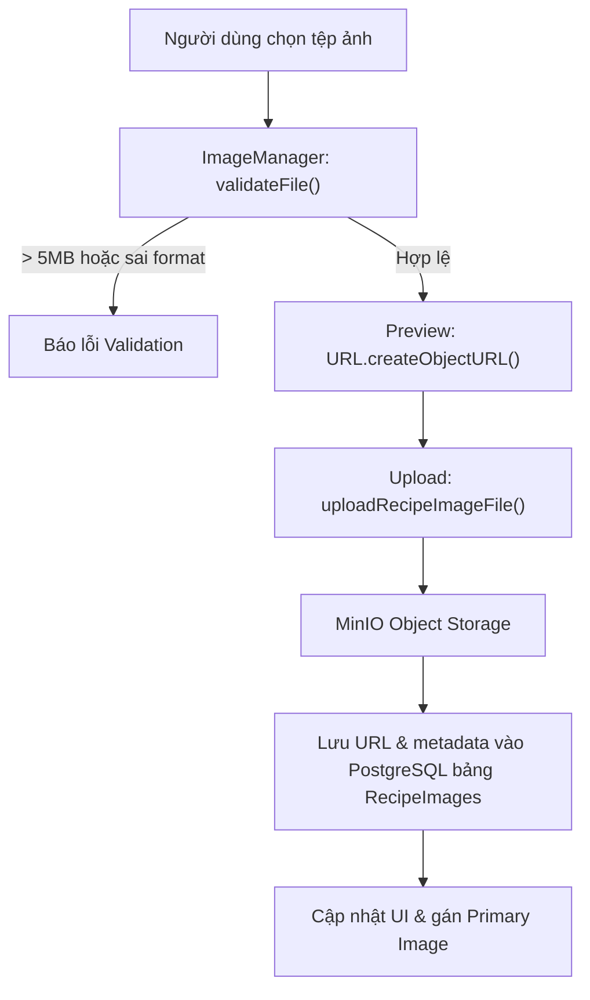

# BÁO CÁO KỸ THUẬT: RECIPE IMAGE MANAGEMENT (TASK 8)

## 1. Thông tin sinh viên & Nhánh Git
- **Sinh viên thực hiện:** Võ Hùng Mạnh
- **MSSV:** 2312687
- **Lớp / Học phần:** Phát triển ứng dụng Web nâng cao (PTUDWNC) — Nhóm 12
- **Nhánh Git:** `feat/vohungmanh-task8-image`
- **Mục tiêu nhánh:** Hoàn thiện toàn diện giao diện và luồng xử lý quản lý hình ảnh công thức (Recipe Image Management) cho Bữa 8 / Task 8, hỗ trợ upload đa định dạng lên MinIO, cơ chế tự động chuyển giao ảnh chính và bộ kiểm thử tự động (Jest & Playwright).

---

## 2. Mục tiêu công việc Task 8
1. **Quản lý danh sách hình ảnh (Recipe Images):** Xem bộ sưu tập ảnh của công thức nấu ăn, hiển thị ảnh xem trước, văn bản thay thế (`AltText`), thứ tự hiển thị (`OrderIndex`).
2. **Tải lên ảnh an toàn (MinIO Object Storage):**
   - Hỗ trợ tải tệp ảnh từ máy tính thông qua `FormData` multipart.
   - Kiểm tra định dạng tệp nghiêm ngặt: chỉ chấp nhận JPEG, PNG, WebP, AVIF.
   - Giới hạn kích thước tệp tối đa 5MB (`validateFile`).
3. **Cơ chế ảnh đại diện (Primary Image):**
   - Đặt ảnh được chọn làm ảnh đại diện chính của công thức qua API `PATCH /recipes/{recipeId}/images/{imageId}/set-primary`.
   - **Đặc tả nghiệp vụ FR-RCP-008:** Khi xóa ảnh đang là Primary, hệ thống tự động phát hiện và chuyển giao quyền Primary cho ảnh có `orderIndex` nhỏ nhất còn lại trong danh sách.
4. **Ràng buộc dữ liệu SRS v1.2.0 (Bảng 7.5):**
   - `AltText`: tối đa 200 ký tự.
   - `ImageUrl`: tối đa 500 ký tự.
   - `OrderIndex`: số nguyên không âm.
5. **Kiểm thử tự động:** Đạt 100% tỷ lệ pass trên toàn bộ test suite đơn vị (Jest / React Testing Library) và kiểm thử đầu cuối (Playwright).

---

## 3. Chức năng triển khai thực tế & Bằng chứng mã nguồn

| STT | Chức năng thực tế | File + Hàm / Component liên quan | Commit liên quan | Cách xác minh / Kiểm thử | Trạng thái |
|:---:|---|---|---|---|:---:|
| 1 | Empty State thân thiện khi chưa có ảnh | `ImageManager.tsx` (`EmptyState`) | `25d649c` | Jest Test #1: kiểm tra text gợi ý tải ảnh | **PASS** |
| 2 | Render danh sách ảnh kèm badge "Ảnh đại diện" & Alt text | `ImageManager.tsx`, `ImageCard.tsx` | `25d649c` | Jest Test #2: kiểm tra badge `Ảnh đại diện` và `alt` | **PASS** |
| 3 | Chặn tệp vượt quá dung lượng 5MB | `ImageManager.tsx` (`validateFile`) | `25d649c` | Jest Test #3: chọn file 6MB -> hiển thị thông báo lỗi | **PASS** |
| 4 | Chặn định dạng không hợp lệ (chỉ nhận JPEG, PNG, WebP, AVIF) | `ImageManager.tsx` (`validateFile`) | `25d649c` | Jest Test #4: chọn file `.gif` / `.pdf` -> từ chối | **PASS** |
| 5 | Hiển thị Preview ảnh khi chọn file hợp lệ | `ImageManager.tsx` (`handleFileSelect`) | `25d649c` | Jest Test #5: kiểm tra `URL.createObjectURL` preview | **PASS** |
| 6 | Thêm ảnh mới trong Direct API mode | `ImageManager.tsx` (`handleAddImage`), `images.ts` (`addRecipeImage`) | `25d649c` | Jest Test #6: gọi API POST và cập nhật state | **PASS** |
| 7 | Validation AltText tối đa 200 ký tự | `ImageManager.tsx` (`validateForm`) | `25d649c` | Jest Test #7: nhập >200 ký tự báo lỗi | **PASS** |
| 8 | Tùy chỉnh OrderIndex khi thêm ảnh | `ImageManager.tsx` (`orderIndexInput`) | `25d649c` | Jest Test #8: nhập thứ tự ưu tiên hiển thị | **PASS** |
| 9 | Đặt làm ảnh đại diện (Set Primary Image) | `ImageManager.tsx` (`handleSetPrimary`), `images.ts` (`setPrimaryRecipeImage`) | `25d649c` | Jest Test #9: gọi API PATCH và đổi badge | **PASS** |
| 10 | Modal xác nhận trước khi xóa ảnh | `ImageManager.tsx` (`handleDeleteClick`) | `25d649c` | Jest Test #10: mở hộp thoại xác nhận | **PASS** |
| 11 | Xóa ảnh thành công khi người dùng xác nhận | `ImageManager.tsx` (`handleConfirmDelete`), `images.ts` (`deleteRecipeImage`) | `25d649c` | Jest Test #11: gọi API DELETE và loại ảnh khỏi UI | **PASS** |
| 12 | Hiển thị Error Banner khi gọi API thất bại | `ImageManager.tsx` (`errorBanner`) | `25d649c` | Jest Test #12: hiển thị banner đỏ thông báo lỗi | **PASS** |
| 13 | Thông báo thân thiện khi dịch vụ lưu trữ gặp lỗi HTTP 503 | `ImageManager.tsx` (`handleUploadError`) | `25d649c` | Jest Test #13: bắt lỗi 503 hiển thị thông báo MinIO bận | **PASS** |
| 14 | Vô hiệu hóa form và nút khi prop `disabled=true` | `ImageManager.tsx` (`disabled`) | `25d649c` | Jest Test #14: kiểm tra thuộc tính disabled trên controls | **PASS** |
| 15 | Validation ImageUrl tối đa 500 ký tự (SRS Bảng 7.5) | `ImageManager.tsx` (`validateForm`) | `25d649c` | Jest Test #15: chặn URL vượt quá 500 ký tự | **PASS** |
| 16 | Xóa ảnh Primary tự động chuyển quyền Primary cho ảnh nhỏ nhất còn lại (FR-RCP-008) | `ImageManager.tsx` (`handleConfirmDelete`) | `25d649c` | Jest Test #16: tự động reassign Primary cho ảnh kế tiếp | **PASS** |

---

## 4. Kiến trúc và công nghệ sử dụng
- **Frontend Framework:** Next.js 14+ (App Router), React 18/19, TypeScript.
- **Styling:** Tailwind CSS.
- **Storage:** MinIO Object Storage (tương thích AWS S3 protocol).
- **Kiểm thử:** Jest, React Testing Library, Playwright E2E.



---

## 5. Danh sách file quan trọng

| STT | Đường dẫn file | Vai trò chính |
|:---:|---|---|
| 1 | `frontend/culinary-blog-web/components/recipe-management/ImageManager.tsx` | Quản lý tải lên, preview, phân quyền, validation và xóa ảnh |
| 2 | `frontend/culinary-blog-web/components/recipe-management/ImageCard.tsx` | Hiển thị từng thẻ ảnh với nút đặt làm ảnh đại diện và xóa |
| 3 | `frontend/culinary-blog-web/lib/api/images.ts` | Module API gọi các endpoint ảnh của Recipe (CRUD, Primary, upload) |
| 4 | `frontend/culinary-blog-web/components/recipe-management/__tests__/ImageManager.test.tsx` | Bộ 16 ca kiểm thử đơn vị tự động kiểm tra toàn bộ logic |
| 5 | `frontend/culinary-blog-web/e2e/image-manager.spec.ts` | Kịch bản kiểm thử E2E tự động Playwright trên trình duyệt |

---

## 6. Hướng dẫn kiểm thử

### 6.1. Chạy Unit Test
Tại thư mục `frontend/culinary-blog-web`:
```bash
npm test -- components/recipe-management/__tests__/ImageManager.test.tsx
```
**Kết quả thực tế đã xác minh:**
```text
PASS components/recipe-management/__tests__/ImageManager.test.tsx
  ImageManager Component
    √ 1. Hiển thị Empty State khi chưa có ảnh nào (32 ms)
    √ 2. Render danh sách ảnh và hiển thị đúng badge Ảnh đại diện cùng Alt text (16 ms)
    √ 3. Từ chối file có kích thước vượt quá 5 MB (11 ms)
    √ 4. Từ chối file có định dạng không được hỗ trợ (chỉ nhận JPEG, PNG, WebP, AVIF) (8 ms)
    √ 5. Hiển thị preview ảnh khi chọn file hợp lệ (9 ms)
    √ 6. Thêm ảnh thành công và gọi addRecipeImage trong Direct API mode (1056 ms)
    √ 7. Validation AltText không vượt quá 200 ký tự (482 ms)
    √ 8. Cho phép tùy chỉnh OrderIndex khi thêm ảnh (108 ms)
    √ 9. Đặt làm ảnh đại diện gọi setPrimaryRecipeImage và cập nhật UI (56 ms)
    √ 10. Bấm nút xóa mở modal yêu cầu xác nhận trước khi thực hiện (34 ms)
    √ 11. Xác nhận xóa ảnh gọi deleteRecipeImage và loại bỏ khỏi danh sách (43 ms)
    √ 12. Hiển thị Error Banner màu đỏ khi API trả về lỗi (49 ms)
    √ 13. Hiển thị thông báo thân thiện khi dịch vụ lưu trữ trả về HTTP 503 (61 ms)
    √ 14. Vô hiệu hóa nút và form khi prop disabled được truyền từ bên ngoài (13 ms)
    √ 15. Validation ImageUrl: Báo lỗi khi URL vượt quá 500 ký tự theo SRS v1.2.0 Bảng 7.5 (12 ms)
    √ 16. Xóa ảnh Primary tự động chuyển quyền Primary cho ảnh có orderIndex nhỏ nhất còn lại (FR-RCP-008) (33 ms)

Test Suites: 1 passed, 1 total
Tests:       16 passed, 16 total
```

### 6.2. Chạy E2E Test (Playwright)
```bash
npx playwright test e2e/image-manager.spec.ts
```

---

## 7. Hạn chế và phạm vi ghi nhận
- Thao tác kéo thả thay đổi vị trí ảnh theo lưới (Grid Drag & Drop) hiện được điều khiển thông qua số thứ tự `OrderIndex` trong form để đảm bảo tính nhất quán với backend API và tương thích mọi trình duyệt di động.
