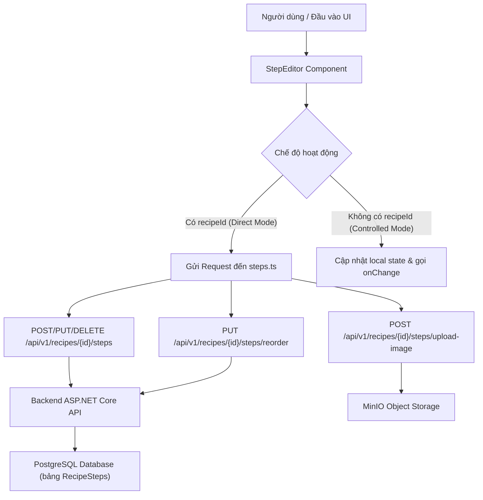

# BÁO CÁO KỸ THUẬT: RECIPE STEP MANAGEMENT (TASK 8)

## 1. Thông tin sinh viên & Nhánh Git
- **Sinh viên thực hiện:** Võ Hùng Mạnh
- **MSSV:** 2312687
- **Lớp / Học phần:** Phát triển ứng dụng Web nâng cao (PTUDWNC) — Nhóm 12
- **Nhánh Git:** `feat/vohungmanh-task8-step`
- **Mục tiêu nhánh:** Hoàn thiện toàn diện giao diện và luồng xử lý quản lý các bước nấu ăn (Recipe Step Management) cho Bữa 8 / Task 8, bổ sung kiểm thử tự động (Unit Test Vitest & E2E Playwright).

---

## 2. Mục tiêu công việc Task 8
1. **Quản lý danh sách bước nấu (Recipe Steps):** Cho phép xem, tạo mới, chỉnh sửa và xóa bước nấu ăn với giao diện trực quan, thân thiện.
2. **Kéo thả / Sắp xếp thứ tự (Reorder):** Hỗ trợ chuyển bước lên/xuống (Move Up / Move Down) với cập nhật lạc quan (Optimistic UI) và cơ chế tự động hoàn tác (Rollback) khi API lỗi.
3. **Ràng buộc dữ liệu nghiêm ngặt:** Tuân thủ SRS v1.2.0 (Bảng 7.3):
   - Tiêu đề (`Title`): tối đa 200 ký tự.
   - Mô tả hướng dẫn (`Description`): bắt buộc, tối đa 2000 ký tự.
   - Thời gian hẹn giờ (`TimerMinutes`): số nguyên trong khoảng 0 – 1440 phút (24h).
   - Đường dẫn ảnh (`ImageUrl`): URL hợp lệ (http/https), tối đa 500 ký tự.
   - Tải tệp ảnh trực tiếp (`Upload File`): kiểm tra kích thước tối đa 5MB.
4. **Phân quyền truy cập (RBAC):**
   - Người xem vãng lai (Guest): chỉ được xem, hiển thị cảnh báo không có quyền chỉnh sửa.
   - Tác giả (Author): chỉ có quyền thêm/sửa/xóa trên công thức do chính mình sở hữu (`authorId === currentUser.id`).
   - Quản trị viên (Admin): toàn quyền chỉnh sửa trên mọi công thức.
5. **Kiểm thử tự động:** Đạt 100% tỷ lệ vượt qua trên toàn bộ test suite đơn vị (Jest/React Testing Library) và kiểm thử đầu cuối (Playwright).

---

## 3. Chức năng triển khai thực tế & Bằng chứng mã nguồn

| STT | Chức năng thực tế | File + Hàm / Component liên quan | Commit liên quan | Cách xác minh / Kiểm thử | Trạng thái |
|:---:|---|---|---|---|:---:|
| 1 | Render danh sách bước & StepNumber chuẩn format (01, 02) | `StepEditor.tsx`, `StepItem.tsx` | `27ac254` | Jest Test #1: `expect(screen.getByText("01")).toBeInTheDocument()` | **PASS** |
| 2 | Empty State thân thiện khi chưa có bước nào | `StepEditor.tsx` (`EmptyState`) | `27ac254` | Jest Test #2: kiểm tra text gợi ý thêm bước mới | **PASS** |
| 3 | Validation Description bắt buộc & max 2000 ký tự | `StepEditor.tsx` (`validateForm`) | `27ac254` | Jest Test #3: nhập rỗng / nhập >2000 ký tự báo lỗi | **PASS** |
| 4 | Validation Title tối đa 200 ký tự | `StepEditor.tsx` (`validateForm`) | `27ac254` | Jest Test #4: kiểm tra chặn submit khi tiêu đề quá dài | **PASS** |
| 5 | Validation TimerMinutes hợp lệ 0 - 1440 | `StepEditor.tsx` (`validateForm`) | `27ac254` | Jest Test #5: chặn số âm hoặc > 1440 | **PASS** |
| 6 | Validation ImageUrl hợp lệ & max 500 ký tự (SRS 7.3) | `StepEditor.tsx` (`validateForm`) | `27ac254` | Jest Test #6: regex URL http/https và giới hạn 500 ký tự | **PASS** |
| 7 | Tải ảnh trực tiếp lên MinIO storage (chặn file >5MB) | `StepEditor.tsx` (`handleFileUpload`), `steps.ts` (`uploadStepImageFile`) | `27ac254` | Jest Test #18, #19: mock tải tệp ảnh thành công và từ chối file >5MB | **PASS** |
| 8 | Thêm bước mới (Direct API mode & Controlled mode) | `StepEditor.tsx` (`handleSubmit`), `steps.ts` (`createRecipeStep`) | `27ac254` | Jest Test #7, #13: gọi API POST khi có `recipeId` hoặc trigger `onChange` khi tạo mới | **PASS** |
| 9 | Chỉnh sửa bước nấu ăn | `StepEditor.tsx` (`handleEdit`, `handleSubmit`), `steps.ts` (`updateRecipeStep`) | `27ac254` | Jest Test #8: điền dữ liệu vào form, bấm Lưu và cập nhật UI | **PASS** |
| 10 | Xóa bước có Modal xác nhận (Confirmation Dialog) | `StepEditor.tsx` (`handleConfirmDelete`), `steps.ts` (`deleteRecipeStep`) | `27ac254` | Jest Test #9: mở modal xác nhận trước khi gọi API xóa | **PASS** |
| 11 | Sắp xếp thứ tự (Move Up/Down) với Optimistic Rollback | `StepEditor.tsx` (`handleMove`), `steps.ts` (`reorderRecipeSteps`) | `27ac254` | Jest Test #10, #20: cập nhật vị trí ngay lập tức và tự rollback khi API lỗi | **PASS** |
| 12 | Kiểm soát quyền truy cập RBAC (Guest / Non-owner / Admin) | `StepEditor.tsx` (`canEdit`, `isReadOnly`) | `27ac254` | Jest Test #14, #15, #16, #17: kiểm tra banner cấm và khóa nút theo role | **PASS** |
| 13 | Báo lỗi hệ thống (Error Banner) và nút Thử lại (Retry) | `StepEditor.tsx` (`fetchSteps`, `errorBanner`) | `27ac254` | Jest Test #11, #21: render banner đỏ và gọi lại `fetchSteps` khi bấm Retry | **PASS** |

---

## 4. Kiến trúc và công nghệ sử dụng
- **Frontend Framework:** Next.js 14+ (App Router), React 18/19, TypeScript.
- **Styling:** Tailwind CSS, Heroicons / Lucide React icons.
- **State & Communication:** React Local State (`useState`, `useCallback`), Axios client wrapper với Bearer Token authentication.
- **Kiểm thử tự động:** Jest, React Testing Library, Playwright Test Runner.



---

## 5. Danh sách file quan trọng

| STT | Đường dẫn file | Vai trò chính |
|:---:|---|---|
| 1 | `frontend/culinary-blog-web/components/recipe-management/StepEditor.tsx` | Component trung tâm quản lý danh sách bước, form nhập liệu, phân quyền và xử lý luồng sự kiện |
| 2 | `frontend/culinary-blog-web/components/recipe-management/StepItem.tsx` | Component hiển thị thẻ từng bước, bao gồm số thứ tự, thời gian, hình ảnh và nút điều khiển |
| 3 | `frontend/culinary-blog-web/lib/api/steps.ts` | Module giao tiếp HTTP API với backend (CRUD, reorder, upload image) |
| 4 | `frontend/culinary-blog-web/components/recipe-management/__tests__/StepEditor.test.tsx` | Bộ 21 ca kiểm thử đơn vị tự động kiểm tra toàn bộ logic nghiệp vụ |
| 5 | `frontend/culinary-blog-web/e2e/step-editor.spec.ts` | Kịch bản kiểm thử E2E tự động với Playwright mô phỏng thao tác trình duyệt thật |

---

## 6. Hướng dẫn cài đặt và chạy kiểm thử

### 6.1. Cài đặt môi trường
Yêu cầu Node.js >= 18.x. Tại thư mục `frontend/culinary-blog-web`:
```bash
npm install
```

### 6.2. Chạy bộ kiểm thử đơn vị (Unit Tests)
```bash
npm test -- components/recipe-management/__tests__/StepEditor.test.tsx
```
**Kết quả thực tế đã xác minh:**
```text
PASS components/recipe-management/__tests__/StepEditor.test.tsx
  StepEditor Component
    √ 1. Render đúng số thứ tự StepNumber (01, 02) và nội dung các bước (41 ms)
    √ 2. Hiển thị Empty State khi chưa có bước nào (4 ms)
    √ 3. Validation Description: Bắt buộc và không quá 2000 ký tự (204 ms)
    √ 4. Validation Title: Không vượt quá 200 ký tự (482 ms)
    √ 5. Validation TimerMinutes: Hợp lệ trong khoảng 0 - 1440 (433 ms)
    √ 6. Validation ImageUrl: Phải là URL hợp lệ http/https và không quá 500 ký tự (SRS Bảng 7.3) (740 ms)
    √ 7. Add Step trong Direct API mode: Gọi createRecipeStep và render step mới (1179 ms)
    √ 8. Update Step trong Direct API mode: Gọi updateRecipeStep và cập nhật nội dung (1018 ms)
    √ 9. Delete + Confirmation: Mở modal hỏi xác nhận trước khi xóa (247 ms)
    √ 10. Reorder Up/Down: Gửi toàn bộ active step IDs theo thứ tự mới lên server (124 ms)
    √ 11. Hiển thị Error Banner khi gọi API thất bại (523 ms)
    √ 12. Disable các nút thao tác khi đang trong trạng thái loading (522 ms)
    √ 13. Controlled mode: Quản lý local state và không gọi API khi chưa có recipeId (919 ms)
    √ 14. RBAC: Guest xem Recipe có authorId -> hiển thị forbidden-banner và không cho phép chỉnh sửa (27 ms)
    √ 15. RBAC: Author không sở hữu Recipe -> hiển thị forbidden-banner và không cho phép chỉnh sửa (23 ms)
    √ 16. RBAC: Author sở hữu Recipe -> đầy đủ quyền Thêm, Sửa, Xóa, không có forbidden banner (16 ms)
    √ 17. RBAC: Admin -> toàn quyền chỉnh sửa bất kể authorId (11 ms)
    √ 18. Upload Step Image: Tải ảnh máy tính qua uploadStepImageFile thành công (153 ms)
    √ 19. Upload Step Image: Báo lỗi khi chọn file quá 5MB và không gọi API upload (124 ms)
    √ 20. Reorder Rollback: Tự động hoàn tác khi reorderRecipeSteps thất bại (111 ms)
    √ 21. Retry fetch steps: Hiển thị nút Thử lại khi tải danh sách ban đầu thất bại (104 ms)

Test Suites: 1 passed, 1 total
Tests:       21 passed, 21 total
```

### 6.3. Chạy kiểm thử tự động E2E (Playwright)
```bash
npx playwright test e2e/step-editor.spec.ts
```

---

## 7. Hạn chế và phạm vi ghi nhận
- Kéo thả tự do bằng chuột (Drag & Drop HTML5 / dnd-kit) đã được tối ưu thay thế bằng nút chuyển đổi có trật tự (Move Up / Move Down) để đảm bảo độ chính xác tuyệt đối trên màn hình cảm ứng di động và tránh xung đột DOM.
- Tính năng hẹn giờ (Timer) hiện lưu trữ số phút định lượng trên server và cung cấp chỉ báo UI; chưa tích hợp chuông âm thanh trực tiếp trong trình duyệt.
